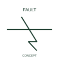

# Insulation-failure indication

An insulation-failure indication identifies the documented insulation-related failure condition.

[Canonical reference](https://eloragrid.ai/symbols/iec-insulation-failure-indication) · [Structured record](../entries/iec-insulation-failure-indication.json) · [All references](README.md)

Updated: 2026-10-27. Drawing use: Schematic. Reference families: IEC, Manufacturer.

Graphical convention: IEC. Insulation-failure indication.

## What it represents

An insulation-failure indication identifies the documented insulation-related failure condition.
Mark the affected conductor, device or insulation boundary clearly.
A failure annotation does not give a resistance measurement or protection setting.

## How to read it

- Mark the affected conductor, device or insulation boundary clearly.
- A failure annotation does not give a resistance measurement or protection setting.

## Drawing checklist

- Identify the associated device, circuit or diagram boundary.
- Mark the affected conductor, device or insulation boundary clearly.
- Cross-reference the equipment data, terminal mapping or operating-state legend needed to interpret the form.

## Important distinction

A failure annotation does not give a resistance measurement or protection setting.

## Facts

- Reference scope: Specific public IEC-context family form
- Publisher reference token: Q021702 (Autodesk token; not a verified IEC database ID)
- Information added: Mark the affected conductor, device or insulation boundary clearly.
- Preview: Independent educational concept; consult the publisher and applicable standard for the exact graphic

## Public references

- [Autodesk IEC-60617 preview: Fault-location and insulation-failure indications](https://help.autodesk.com/cloudhelp/2021/ENU/AutoCAD-Electrical/files/GUID-2FA15F09-EF4C-4996-AB3C-FAD4E8A29DBA.htm) — Autodesk. Official public publisher family name and reference context; vendor identifiers and graphics are distinct from licensed IEC database content.

## Related references

- [Current transformer](current-transformer.md)
- [Voltage transformer](voltage-transformer.md)

Original educational concept geometry, CC BY 4.0. Unitless; not a certified standards glyph or manufacturer footprint.

Elora-authored explanations are CC BY 4.0. Linked standards and manufacturer material retain their own rights. Confirm project requirements using primary sources.
