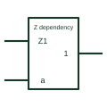

# IEC interconnection dependency (Z)

Dependency label Zm showing an internal connection from one point of a symbol to every terminal labelled m.

[Canonical reference](https://eloragrid.ai/symbols/iec-interconnection-dependency-z) · [Structured record](../entries/iec-interconnection-dependency-z.json) · [All references](README.md)

Updated: 2026-10-28. Drawing use: Schematic. Reference families: IEC, Manufacturer.

Graphical convention: IEC. Output or internal output labelled Zm with affected terminals labelled m.

## What it represents

Z dependency states that the affecting input or output is internally connected to every input or output labelled with the same number, which then takes its logic state. It lets a symbol show internal wiring without drawing it, for example an internal output that drives several internal inputs.
On device symbols, Z dependency often explains why an output appears to have the same state as an internal signal or why a pin also acts on another function. Drafters reproducing such symbols should keep the labels together.
Z dependency indicates logic state transfer only. It does not imply the connection is externally accessible or measurable.

## How to read it

- Trace each Zm to every terminal labelled m.
- Z labels describe internal connections, not external wiring.

## Drawing checklist

- Label the source as Zm.
- Mark each connected terminal with m.
- Do not use Z labels to stand in for external wiring.

## Important distinction

X (transmission) dependency describes a bidirectional switch path controlled by the affecting input; Z is a fixed logical connection.

## Facts

- Meaning: Internal logic connection
- Typical use: Internal outputs feeding several functions
- Artwork scope: Original educational illustration; consult the applicable standard and the selected device documentation for the exact graphic

## Public references

- [Overview of IEEE Standard 91-1984: explanation of logic symbols (SDYZ001A)](https://www.ti.com/lit/ml/sdyz001a/sdyz001a.pdf) — Texas Instruments. Z (interconnection) dependency description.

## Related references

- [IEC AND dependency (G)](iec-and-dependency-g.md)
- [IEC control dependency (C)](iec-control-dependency-c.md)
- [IEC common-control block](iec-common-control-block.md)

Original educational concept geometry, CC BY 4.0. Unitless; not a certified standards glyph or manufacturer footprint.

Elora-authored explanations are CC BY 4.0. Linked standards and manufacturer material retain their own rights. Confirm project requirements using primary sources.
