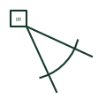

# Intruder motion detector plan symbol

Security plan symbol for a passive infrared or dual-technology motion detector reporting to an intruder alarm.

[Canonical reference](https://eloragrid.ai/symbols/iec-intruder-motion-detector) · [Structured record](../entries/iec-intruder-motion-detector.json) · [All references](README.md)

Updated: 2026-10-28. Drawing use: GA. Reference families: IEC.

Graphical convention: IEC. Motion detector, intruder alarm.

## What it represents

Intruder motion detectors sense movement, usually by passive infrared, sometimes combined with microwave. Security plans draw a small box or semicircle at the corner mounting position with the detection fan drawn into the room so coverage can be checked.
Each detector is wired to an alarm panel zone or an addressable bus, and the plan tags its zone. Detectors must not see heaters, moving curtains or direct sunlight, so the fan on the plan is a practical design check. The symbol does not state pet immunity, technology or masking detection. The security schedule records these.

## How to read it

- Check the coverage fan against windows and heat sources.
- Read the zone tag.

## Drawing checklist

- Show coverage fan.
- Tag zone.
- State detector technology.

## Important distinction

A lighting presence detector switches luminaires; this detector reports to an intruder alarm system.

## Facts

- Sensing: Passive infrared, sometimes with microwave
- System: Intruder alarm
- Exact standard graphic: Not reproduced here; confirm the form against IEC 60617 and the project legend

## Public references

- [IEC graphical symbols for diagrams](https://tc3.iec.ch/tc-activity/graphical-symbols-for-diagrams/) — IEC. IEC graphical symbol context for installation and communication plans; independently drawn here.
- [Autodesk IEC-60617 preview: Radiation qualifiers](https://help.autodesk.com/cloudhelp/2021/ENU/AutoCAD-Electrical/files/GUID-EABC81B4-549D-49C9-A0F5-086DD204A689.htm) — Autodesk. Public IEC-oriented radiation qualifiers relevant to infrared and optical marks.
- [Electrical installation design methodology and references](https://www.electrical-installation.org/enwiki/General_rules_of_electrical_installation_design) — Schneider Electric — Electrical Installation Guide. Installation design context for coordinating low-current systems with power and lighting.

## Related references

- [Lighting presence detector plan mark](iec-presence-detector-lighting.md)
- [Door contact plan symbol](iec-door-contact-plan-symbol.md)
- [CCTV camera plan symbol](iec-cctv-camera-plan-symbol.md)

Original educational concept geometry, CC BY 4.0. Unitless; not a certified standards glyph or manufacturer footprint.

Elora-authored explanations are CC BY 4.0. Linked standards and manufacturer material retain their own rights. Confirm project requirements using primary sources.
