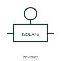

# Isolation-function qualifier

An isolation qualifier identifies the documented disconnector function attached to a switching representation.

[Canonical reference](https://eloragrid.ai/symbols/iec-isolation-function-qualifier) · [Structured record](../entries/iec-isolation-function-qualifier.json) · [All references](README.md)

Updated: 2026-10-27. Drawing use: SLD, Schematic. Reference families: IEC, Manufacturer.

Graphical convention: IEC. Isolation-function qualifier.

## What it represents

An isolation qualifier identifies the documented disconnector function attached to a switching representation. Isolation is a device function that must be distinguished from the ability to interrupt load current or clear faults. A switching representation can therefore carry an isolation qualifier alongside other functional information.
On an SLD, keep the associated device identity and switching function readable. The selected equipment data establishes the actual isolation and operating requirements.

## How to read it

- Distinguish isolation capability from load interruption and automatic tripping.
- The qualifier does not give isolation clearances or an equipment rating.

## Drawing checklist

- Identify the associated device, circuit or diagram boundary.
- Distinguish isolation capability from load interruption and automatic tripping.
- Cross-reference the equipment data, terminal mapping or operating-state legend needed to interpret the form.

## Important distinction

The qualifier does not give isolation clearances or an equipment rating.

## Facts

- Reference scope: Specific public IEC-context family form
- Publisher reference token: Q070103 (Autodesk token; not a verified IEC database ID)
- Information added: Distinguish isolation capability from load interruption and automatic tripping.
- Preview: Independent educational concept; consult the publisher and applicable standard for the exact graphic

## Public references

- [Autodesk IEC-60617 preview: Operating-device and function qualifiers](https://help.autodesk.com/cloudhelp/2021/ENU/AutoCAD-Electrical/files/GUID-3598E18D-9F8A-48CE-83D0-4CEBA0AE869C.htm) — Autodesk. Official public publisher family name and reference context; vendor identifiers and graphics are distinct from licensed IEC database content.

## Related references

- [Power converter / inverter](power-converter.md)
- [Generic electrical load](generic-electrical-load.md)

Original educational concept geometry, CC BY 4.0. Unitless; not a certified standards glyph or manufacturer footprint.

Elora-authored explanations are CC BY 4.0. Linked standards and manufacturer material retain their own rights. Confirm project requirements using primary sources.
