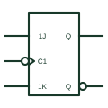

# IEC JK flip-flop (rectangular form)

IEC bistable with 1J and 1K inputs controlled by a dynamic C1 clock; J=K=1 toggles the state.

[Canonical reference](https://eloragrid.ai/symbols/iec-jk-flip-flop) · [Structured record](../entries/iec-jk-flip-flop.json) · [All references](README.md)

Updated: 2026-10-28. Drawing use: Schematic. Reference families: IEC, Manufacturer.

Graphical convention: IEC. Rectangular bistable with 1J, 1K and dynamic C1 inputs.

## What it represents

The IEC JK flip-flop has inputs labelled 1J and 1K, both controlled by C1. On the active clock transition J=1, K=0 sets; J=0, K=1 resets; J=K=1 toggles; and J=K=0 holds. A negation mark outside the C1 input with the wedge indicates a falling-edge device.
JK devices are used in counters and divider chains. On IEC drawings check the clock marking carefully, because rising-edge and falling-edge versions are visually similar and mixing them changes counter sequencing.
The rectangle does not reveal whether the device is edge-triggered or pulse-triggered unless the clock and output marks are read together. A postponed output mark indicates a pulse-triggered type.

## How to read it

- Read the clock edge from the wedge and any external negation.
- Look for postponed output marks.

## Drawing checklist

- Label J and K with the C prefix.
- Show the active clock edge clearly.
- Show asynchronous S and R inputs where present.

## Important distinction

An IEC T flip-flop has a single 1T input; a JK with J and K tied high behaves the same way.

## Facts

- Key labels: 1J, 1K, C1
- J=K=1: Toggle on active edge
- Artwork scope: Original educational illustration; consult the applicable standard and the selected device documentation for the exact graphic

## Public references

- [Overview of IEEE Standard 91-1984: explanation of logic symbols (SDYZ001A)](https://www.ti.com/lit/ml/sdyz001a/sdyz001a.pdf) — Texas Instruments. Bistable element types and J, K label meanings.
- [SN74HC112 — negative-edge JK flip-flops](https://www.ti.com/lit/ds/symlink/sn74hc112.pdf) — Texas Instruments. Negative-edge JK flip-flop documentation.

## Related references

- [Negative-edge JK flip-flop](negative-edge-jk-flip-flop.md)
- [IEC T (toggle) flip-flop](iec-t-flip-flop.md)
- [IEC dynamic input with negation (falling edge)](iec-falling-edge-dynamic-input.md)

Original educational concept geometry, CC BY 4.0. Unitless; not a certified standards glyph or manufacturer footprint.

Elora-authored explanations are CC BY 4.0. Linked standards and manufacturer material retain their own rights. Confirm project requirements using primary sources.
