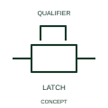

# Key-controlled two-way latching device

This form identifies a two-way latch using a documented key operation.

[Canonical reference](https://eloragrid.ai/symbols/iec-key-controlled-two-way-latching-device) · [Structured record](../entries/iec-key-controlled-two-way-latching-device.json) · [All references](README.md)

Updated: 2026-10-27. Drawing use: Schematic. Reference families: IEC, Manufacturer.

Graphical convention: IEC. Key-controlled two-way latching device.

## What it represents

This form identifies a two-way latch using a documented key operation. A key controls the movement or release of the two-way latching arrangement. Its role is mechanical access/operation, while the associated electrical circuit retains its own contact logic.
Keep key identifiers and device tags consistent with the interlocking schedule. A single keyed-latch graphic cannot describe all exchanges in a multi-key sequence.

## How to read it

- Cross-reference the key arrangement and retained mechanism positions.
- A keyed latch does not establish a complete trapped-key sequence by itself.

## Drawing checklist

- Identify the associated device, circuit or diagram boundary.
- Cross-reference the key arrangement and retained mechanism positions.
- Cross-reference the equipment data, terminal mapping or operating-state legend needed to interpret the form.

## Important distinction

A keyed latch does not establish a complete trapped-key sequence by itself.

## Facts

- Reference scope: Specific public IEC-context family form
- Publisher reference token: Q1029603 (Autodesk token; not a verified IEC database ID)
- Information added: Cross-reference the key arrangement and retained mechanism positions.
- Preview: Independent educational concept; consult the publisher and applicable standard for the exact graphic

## Public references

- [Autodesk IEC-60617 preview: Latching-device qualifiers](https://help.autodesk.com/cloudhelp/2021/ENU/AutoCAD-Electrical/files/GUID-9FC7824E-1A3B-4B47-B157-590CB8AE62FC.htm) — Autodesk. Official public publisher family name and reference context; vendor identifiers and graphics are distinct from licensed IEC database content.

## Related references

- [Relay coil](relay-coil.md)
- [Normally open contact](normally-open-contact.md)

Original educational concept geometry, CC BY 4.0. Unitless; not a certified standards glyph or manufacturer footprint.

Elora-authored explanations are CC BY 4.0. Linked standards and manufacturer material retain their own rights. Confirm project requirements using primary sources.
