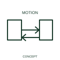

# Limited two-way rotary-motion qualifier

This qualifier identifies rotary movement in both directions over a limited travel.

[Canonical reference](https://eloragrid.ai/symbols/iec-limited-two-way-rotary-motion-qualifier) · [Structured record](../entries/iec-limited-two-way-rotary-motion-qualifier.json) · [All references](README.md)

Updated: 2026-10-27. Drawing use: Schematic. Reference families: IEC, Manufacturer.

Graphical convention: IEC. Limited two-way rotary-motion qualifier.

## What it represents

This qualifier identifies rotary movement in both directions over a limited travel. A mechanism can move clockwise and counterclockwise between defined positions without rotating indefinitely. This distinction is useful for actuators and position-changing mechanisms.
State the end positions or stops in the mechanism documentation. The qualifier itself supplies neither angular travel nor the electrical control sequence.

## How to read it

- Record the mechanism's defined end positions separately.
- A limited-travel qualifier gives no numerical angular range.

## Drawing checklist

- Identify the associated device, circuit or diagram boundary.
- Record the mechanism's defined end positions separately.
- Cross-reference the equipment data, terminal mapping or operating-state legend needed to interpret the form.

## Important distinction

A limited-travel qualifier gives no numerical angular range.

## Facts

- Reference scope: Specific public IEC-context family form
- Publisher reference token: Q020405 (Autodesk token; not a verified IEC database ID)
- Information added: Record the mechanism's defined end positions separately.
- Preview: Independent educational concept; consult the publisher and applicable standard for the exact graphic

## Public references

- [Autodesk IEC-60617 preview: Rotary force and motion qualifiers](https://help.autodesk.com/cloudhelp/2021/ENU/AutoCAD-Electrical/files/GUID-A2633343-7A99-4CAF-BF09-F108A4714D55.htm) — Autodesk. Official public publisher family name and reference context; vendor identifiers and graphics are distinct from licensed IEC database content.

## Related references

- [Relay coil](relay-coil.md)
- [Normally open contact](normally-open-contact.md)

Original educational concept geometry, CC BY 4.0. Unitless; not a certified standards glyph or manufacturer footprint.

Elora-authored explanations are CC BY 4.0. Linked standards and manufacturer material retain their own rights. Confirm project requirements using primary sources.
