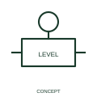

# Liquid-level actuation qualifier

This qualifier identifies actuation responding to liquid level.

[Canonical reference](https://eloragrid.ai/symbols/iec-liquid-level-actuation-qualifier) · [Structured record](../entries/iec-liquid-level-actuation-qualifier.json) · [All references](README.md)

Updated: 2026-10-27. Drawing use: Schematic. Reference families: IEC, Manufacturer.

Graphical convention: IEC. Liquid-level actuation qualifier.

## What it represents

This qualifier identifies actuation responding to liquid level. Level is the process condition that initiates operation. It should be distinguished from a drawing of the level instrument, the electrical output contact and the control action that follows.
In a generator fuel system, for example, a level input may participate in pump control or an alarm. The qualifier identifies the input principle while the cause-and-effect schedule states what happens.

## How to read it

- State the sensed vessel or level point and the associated contact condition.
- A level-actuation qualifier does not provide a setpoint or switch mounting height.

## Drawing checklist

- Identify the associated device, circuit or diagram boundary.
- State the sensed vessel or level point and the associated contact condition.
- Cross-reference the equipment data, terminal mapping or operating-state legend needed to interpret the form.

## Important distinction

A level-actuation qualifier does not provide a setpoint or switch mounting height.

## Facts

- Reference scope: Specific public IEC-context family form
- Publisher reference token: Q021401 (Autodesk token; not a verified IEC database ID)
- Information added: State the sensed vessel or level point and the associated contact condition.
- Preview: Independent educational concept; consult the publisher and applicable standard for the exact graphic

## Public references

- [Autodesk IEC-60617 preview: Operating-device and function qualifiers](https://help.autodesk.com/cloudhelp/2021/ENU/AutoCAD-Electrical/files/GUID-3598E18D-9F8A-48CE-83D0-4CEBA0AE869C.htm) — Autodesk. Official public publisher family name and reference context; vendor identifiers and graphics are distinct from licensed IEC database content.

## Related references

- [Relay coil](relay-coil.md)
- [Normally open contact](normally-open-contact.md)

Original educational concept geometry, CC BY 4.0. Unitless; not a certified standards glyph or manufacturer footprint.

Elora-authored explanations are CC BY 4.0. Linked standards and manufacturer material retain their own rights. Confirm project requirements using primary sources.
