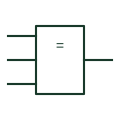

# IEC logic identity element

Element marked = whose output is active only when all inputs stand at the same logic state.

[Canonical reference](https://eloragrid.ai/symbols/iec-logic-identity-element) · [Structured record](../entries/iec-logic-identity-element.json) · [All references](README.md)

Updated: 2026-10-28. Drawing use: Schematic. Reference families: IEC, Manufacturer.

Graphical convention: IEC. Rectangular element with the = general qualifier.

## What it represents

The = qualifier defines a logic identity function: the output is active when every input is in the same state, whether all active or all inactive. For two inputs this is the equivalence or exclusive-NOR function, but with three or more inputs it is a distinct agreement check.
Identity elements are useful for voting and agreement logic, such as confirming that three redundant transmitters agree before allowing an action. The drawing should state what happens on disagreement, since the element only reports whether agreement exists.
The symbol does not provide majority selection. If two-out-of-three voting is intended, a different element or a combination of AND and OR elements is needed.

## How to read it

- With three or more inputs, read = as all equal, not as majority.
- Check what downstream logic does on a disagreement.

## Drawing checklist

- Use = only where full agreement is intended.
- Label redundant inputs with their channel identifiers.
- Show the disagreement response on the same sheet.

## Important distinction

A negated =1 element means not exactly one active; it matches identity only for two inputs.

## Facts

- Qualifier: = (all inputs same state)
- Two-input equivalent: Exclusive-NOR
- Artwork scope: Original educational illustration; consult the applicable standard and the selected device documentation for the exact graphic

## Public references

- [Overview of IEEE Standard 91-1984: explanation of logic symbols (SDYZ001A)](https://www.ti.com/lit/ml/sdyz001a/sdyz001a.pdf) — Texas Instruments. Defines the = logic identity qualifier.

## Related references

- [IEC exclusive-NOR gate (rectangular form)](iec-xnor-gate.md)
- [Exclusive-NOR gate](logic-xnor-gate.md)
- [IEC even-parity element](iec-even-parity-element.md)

Original educational concept geometry, CC BY 4.0. Unitless; not a certified standards glyph or manufacturer footprint.

Elora-authored explanations are CC BY 4.0. Linked standards and manufacturer material retain their own rights. Confirm project requirements using primary sources.
