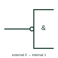

# IEC logic negation at input

Small circle where an input meets an outline: an external 0 produces the internal 1 (active) state.

[Canonical reference](https://eloragrid.ai/symbols/iec-logic-input-negation) · [Structured record](../entries/iec-logic-input-negation.json) · [All references](README.md)

Updated: 2026-10-28. Drawing use: Schematic. Reference families: IEC, Manufacturer.

Graphical convention: IEC. Small circle at the input edge of the outline.

## What it represents

The negation circle at an input means that the external 0 state produces the internal 1 state of the element. It is a pure logic statement: to relate it to voltage levels, the drawing must declare positive or negative logic. TI's public overview notes that this is the older form, with the polarity triangle now preferred in device data books.
On functional logic diagrams for control systems, input negation is a compact way to show normally-closed or fault-healthy signals entering a gate without drawing a separate inverter. The reader should confirm the declared logic convention before relating a circle to a contact state or voltage.
A negation circle does not specify how the inversion is implemented. It may be a separate inverter, an internal feature of the device, or a negated contact in a PLC rung.

## How to read it

- Check the sheet note for positive or negative logic.
- Do not confuse the circle with a connection dot or terminal.

## Drawing checklist

- Draw the circle touching the outline.
- Declare the logic convention on the drawing.
- Avoid mixing negation circles and polarity triangles on one sheet.

## Important distinction

The polarity indicator triangle states an active-low level directly and does not depend on a declared logic convention.

## Facts

- Meaning: External 0 produces internal 1
- Dependency: Needs a declared logic convention to map to levels
- Artwork scope: Original educational illustration; consult the applicable standard and the selected device documentation for the exact graphic

## Public references

- [Overview of IEEE Standard 91-1984: explanation of logic symbols (SDYZ001A)](https://www.ti.com/lit/ml/sdyz001a/sdyz001a.pdf) — Texas Instruments. Defines logic negation at an input and its relation to logic conventions.

## Related references

- [IEC logic negation at output](iec-logic-output-negation.md)
- [IEC polarity indicator at input (active-low input)](iec-active-low-input-indicator.md)
- [IEC AND gate (rectangular form)](iec-and-gate.md)

Original educational concept geometry, CC BY 4.0. Unitless; not a certified standards glyph or manufacturer footprint.

Elora-authored explanations are CC BY 4.0. Linked standards and manufacturer material retain their own rights. Confirm project requirements using primary sources.
