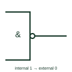

# IEC logic negation at output

Circle on an output edge meaning the internal 1 state of the element produces an external 0.

[Canonical reference](https://eloragrid.ai/symbols/iec-logic-output-negation) · [Structured record](../entries/iec-logic-output-negation.json) · [All references](README.md)

Updated: 2026-10-28. Drawing use: Schematic. Reference families: IEC, Manufacturer.

Graphical convention: IEC. Small circle at the output edge of the outline.

## What it represents

Output negation turns AND into NAND, OR into NOR and a buffer into an inverter. The circle sits where the output line meets the outline and states that the internal 1 state produces the external 0 state. As with input negation, a logic convention must be declared to relate this to voltage levels.
Drafters use output negation to avoid drawing separate inverters. When a negated output feeds a negated input on the next element, the two cancel, and reviewers often simplify the drawing by removing both.
The circle carries no information about output drive type or loading. Open-circuit or three-state behaviour needs its own qualifier inside the outline.

## How to read it

- Look for double negations between elements that cancel.
- Confirm the logic convention declared for the sheet.

## Drawing checklist

- Place the circle at the outline edge, not along the line.
- Declare the logic convention.
- Simplify cancelling negations where the hardware allows.

## Important distinction

An active-low output triangle states the level directly and is the data-book alternative.

## Facts

- Meaning: Internal 1 produces external 0
- Effect on & element: Gives NAND
- Artwork scope: Original educational illustration; consult the applicable standard and the selected device documentation for the exact graphic

## Public references

- [Overview of IEEE Standard 91-1984: explanation of logic symbols (SDYZ001A)](https://www.ti.com/lit/ml/sdyz001a/sdyz001a.pdf) — Texas Instruments. Defines logic negation at an output.

## Related references

- [IEC logic negation at input](iec-logic-input-negation.md)
- [IEC polarity indicator at output (active-low output)](iec-active-low-output-indicator.md)
- [IEC NAND gate (rectangular form)](iec-nand-gate.md)

Original educational concept geometry, CC BY 4.0. Unitless; not a certified standards glyph or manufacturer footprint.

Elora-authored explanations are CC BY 4.0. Linked standards and manufacturer material retain their own rights. Confirm project requirements using primary sources.
