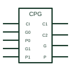

# IEC look-ahead carry generator (CPG)

IEC element marked CPG that computes carries for several adder stages at once to speed up arithmetic.

[Canonical reference](https://eloragrid.ai/symbols/iec-look-ahead-carry-generator) · [Structured record](../entries/iec-look-ahead-carry-generator.json) · [All references](README.md)

Updated: 2026-10-28. Drawing use: Schematic. Reference families: IEC, Manufacturer.

Graphical convention: IEC. Rectangular element with CPG qualifier.

## What it represents

The CPG qualifier identifies a look-ahead carry generator. It takes carry generate and carry propagate signals from several adder or ALU stages and produces their carry inputs in parallel, avoiding the delay of a rippling carry chain.
On block diagrams of arithmetic sections the CPG sits beside a row of ALUs, with generate and propagate lines going in and carry lines coming out. Recognising it explains why carries do not pass directly from one ALU to the next.
The symbol does not indicate how many stages it serves; count the input groups or refer to the device data. Label the carry input and output ordering explicitly so the arithmetic stages cannot be connected in the wrong significance order.

## How to read it

- Generate and propagate lines come from each arithmetic stage.
- Carries return to each stage in parallel.

## Drawing checklist

- Mark the element CPG.
- Label generate, propagate and carry lines per stage.
- Show the stage count.

## Important distinction

A ripple-carry arrangement chains CO to CI directly with no CPG element.

## Facts

- Qualifier: CPG
- Purpose: Parallel carry calculation
- Artwork scope: Original educational illustration; consult the applicable standard and the selected device documentation for the exact graphic

## Public references

- [Overview of IEEE Standard 91-1984: explanation of logic symbols (SDYZ001A)](https://www.ti.com/lit/ml/sdyz001a/sdyz001a.pdf) — Texas Instruments. Lists CPG as the look-ahead carry generator qualifier.

## Related references

- [IEC arithmetic logic unit (ALU)](iec-arithmetic-logic-unit.md)
- [IEC adder (Σ)](iec-full-adder.md)
- [Binary full adder](binary-full-adder.md)

Original educational concept geometry, CC BY 4.0. Unitless; not a certified standards glyph or manufacturer footprint.

Elora-authored explanations are CC BY 4.0. Linked standards and manufacturer material retain their own rights. Confirm project requirements using primary sources.
