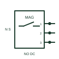

# IEC magnetic proximity sensor: normally open 3 wire with connector

Magnetic proximity sensor form: Normally Open 3 Wire with connector.

[Canonical reference](https://eloragrid.ai/symbols/iec-magnetic-proximity-sensor-normally-open-3-wire-with-connector) · [Structured record](../entries/iec-magnetic-proximity-sensor-normally-open-3-wire-with-connector.json) · [All references](README.md)

Updated: 2026-10-28. Drawing use: Schematic. Reference families: IEC, Manufacturer.

Graphical convention: IEC. Normally Open 3 Wire with connector.

## What it represents

A magnetic proximity sensor responds to a magnetic field or a target carrying the specified magnet. This entry identifies the normally open 3 wire with connector form in the publisher's IEC-context family.
A piston magnet or door-mounted magnet can provide a position indication without direct mechanical contact. The normally-open designation starts with a non-conducting output or open contact in the documented reference condition; operation changes that state. The three-wire form distinguishes supply, return and switching output. Confirm sourcing or sinking operation from the actual sensor circuit before connecting it to an input.
The connector variant adds a separable field interface. Keep the mating connector designation, pin numbers and cable-core mapping visible at that boundary. A magnetic sensor can contain a reed contact or powered electronics. The actual output, field orientation and contact ratings must come from the selected device.

## How to read it

- The normally-open designation starts with a non-conducting output or open contact in the documented reference condition; operation changes that state.
- The three-wire form distinguishes supply, return and switching output. Confirm sourcing or sinking operation from the actual sensor circuit before connecting it to an input.
- The connector variant adds a separable field interface. Keep the mating connector designation, pin numbers and cable-core mapping visible at that boundary.
- A magnetic sensor can contain a reed contact or powered electronics. The actual output, field orientation and contact ratings must come from the selected device.

## Drawing checklist

- Identify the target, sensing mode and expected normal condition.
- Label supply, output and connector pins from the actual device diagram.
- Reference output circuit type, operating range and controller input.

## Important distinction

This entry adds the normally open 3 wire with connector detail to the broader magnetic proximity sensor family. A magnetic sensor can contain a reed contact or powered electronics. The actual output, field orientation and contact ratings must come from the selected device.

## Facts

- Drawing form: Normally Open 3 Wire with connector
- Public vendor block names: HPX11M3C / VPX11M3C. Autodesk identifiers, not standards database IDs.
- Drawing purpose: magnetic proximity sensor
- Graphic scope: Independently authored educational illustration; not certified standard geometry, a terminal pinout or a product footprint.

## Public references

- [AutoCAD Electrical: Magnetic proximity switches](https://help.autodesk.com/cloudhelp/2021/ENU/AutoCAD-Electrical/files/GUID-B80666C6-215A-40C9-93CD-F394C29C3D33.htm) — Autodesk. Public Magnetic Switches table explicitly lists HPX11M3C / VPX11M3C with this operating or connection form. Vendor graphics are linked, not copied.

## Related references

- [Magnetic proximity switch](magnetic-proximity-switch.md)
- [PLC digital input](plc-digital-input.md)
- [Terminal connection](terminal.md)

Original educational concept geometry, CC BY 4.0. Unitless; not a certified standards glyph or manufacturer footprint.

Elora-authored explanations are CC BY 4.0. Linked standards and manufacturer material retain their own rights. Confirm project requirements using primary sources.
