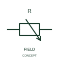

# Magnetoresistive element

This representation identifies a resistive element whose response is associated with a magnetic field.

[Canonical reference](https://eloragrid.ai/symbols/iec-magnetoresistive-element) · [Structured record](../entries/iec-magnetoresistive-element.json) · [All references](README.md)

Updated: 2026-10-27. Drawing use: Schematic. Reference families: IEC, Manufacturer.

Graphical convention: IEC. Magnetoresistive element.

## What it represents

This representation identifies a resistive element whose response is associated with a magnetic field. The component is a resistive sensing element associated with a magnetic field. It can participate in a larger measurement circuit rather than providing a ready-made contact output.
Identify any bridge, conditioning or controller input associated with the element. A magnetically operated switch has a different electrical output description.

## How to read it

- Document the sensing circuit and output conditioning separately.
- A magnetoresistive element is distinct from a magnetic contact switch.

## Drawing checklist

- Identify the associated device, circuit or diagram boundary.
- Document the sensing circuit and output conditioning separately.
- Cross-reference the equipment data, terminal mapping or operating-state legend needed to interpret the form.

## Important distinction

A magnetoresistive element is distinct from a magnetic contact switch.

## Facts

- Reference scope: Specific public IEC-context family form
- Publisher reference token: HVR1S00689 (Autodesk token; not a verified IEC database ID)
- Information added: Document the sensing circuit and output conditioning separately.
- Preview: Independent educational concept; consult the publisher and applicable standard for the exact graphic

## Public references

- [Resistors and heater-element symbols](https://help.autodesk.com/cloudhelp/2021/ENU/AutoCAD-Electrical/files/GUID-1D071951-D38E-4B15-8B9E-C30ECBD55C19.htm) — Autodesk. Official public publisher family name and reference context; vendor identifiers and graphics are distinct from licensed IEC database content.

## Related references

- [Resistor](resistor.md)
- [Capacitor](capacitor.md)

Original educational concept geometry, CC BY 4.0. Unitless; not a certified standards glyph or manufacturer footprint.

Elora-authored explanations are CC BY 4.0. Linked standards and manufacturer material retain their own rights. Confirm project requirements using primary sources.
