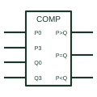

# IEC magnitude comparator (COMP)

IEC COMP element comparing two binary words P and Q, with outputs for P>Q, P=Q and P<Q.

[Canonical reference](https://eloragrid.ai/symbols/iec-magnitude-comparator) · [Structured record](../entries/iec-magnitude-comparator.json) · [All references](README.md)

Updated: 2026-10-28. Drawing use: Schematic. Reference families: IEC, Manufacturer.

Graphical convention: IEC. Rectangular element with COMP qualifier and P, Q input groups.

## What it represents

The IEC magnitude comparator is marked COMP. Its inputs are grouped as word P and word Q with binary weights, and its outputs are labelled P\>Q, P=Q and P\<Q. Cascading inputs carry the same labels in a separate group so that comparators can be chained for longer words.
Digital comparators appear in set-point logic, address matching and limit checking. A reviewer should confirm the bit order of P and Q, because a swapped weight produces a comparison that is correct only for some values.
The symbol does not indicate whether the comparison is for signed or unsigned numbers. Standard devices compare unsigned binary.

## How to read it

- Check bit weights on both words.
- Cascade inputs are needed for words longer than one device.

## Drawing checklist

- Group and weight the P and Q inputs.
- Label all three outputs.
- Show cascade connections.

## Important distinction

An analogue voltage comparator compares two voltages, not binary words.

## Facts

- Qualifier: COMP
- Outputs: P\>Q, P=Q, P\<Q
- Artwork scope: Original educational illustration; consult the applicable standard and the selected device documentation for the exact graphic

## Public references

- [Overview of IEEE Standard 91-1984: explanation of logic symbols (SDYZ001A)](https://www.ti.com/lit/ml/sdyz001a/sdyz001a.pdf) — Texas Instruments. Lists COMP as the magnitude comparator qualifier.
- [CD74HC85 — digital magnitude comparators](https://www.ti.com/product/CD74HC85) — Texas Instruments. Magnitude comparator documentation.

## Related references

- [Digital magnitude comparator](digital-magnitude-comparator.md)
- [Voltage comparator](voltage-comparator.md)
- [IEC arithmetic logic unit (ALU)](iec-arithmetic-logic-unit.md)

Original educational concept geometry, CC BY 4.0. Unitless; not a certified standards glyph or manufacturer footprint.

Elora-authored explanations are CC BY 4.0. Linked standards and manufacturer material retain their own rights. Confirm project requirements using primary sources.
