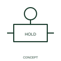

# Maintained-position qualifier

A maintained-position qualifier indicates that the operating position remains after actuation.

[Canonical reference](https://eloragrid.ai/symbols/iec-maintained-position-qualifier) · [Structured record](../entries/iec-maintained-position-qualifier.json) · [All references](README.md)

Updated: 2026-10-27. Drawing use: Schematic. Reference families: IEC, Manufacturer.

Graphical convention: IEC. Maintained-position qualifier.

## What it represents

A maintained-position qualifier indicates that the operating position remains after actuation. The mechanism retains the selected position after the operating action ends. The next manual action, release or other documented event changes that retained state.
This is especially useful when a maintained selector and a momentary command appear in the same control circuit. Draw their contact states and release relationships explicitly.

## How to read it

- State the action required to release or change the maintained state.
- Maintained operation differs from a timed hold and from automatic spring return.

## Drawing checklist

- Identify the associated device, circuit or diagram boundary.
- State the action required to release or change the maintained state.
- Cross-reference the equipment data, terminal mapping or operating-state legend needed to interpret the form.

## Important distinction

Maintained operation differs from a timed hold and from automatic spring return.

## Facts

- Reference scope: Specific public IEC-context family form
- Publisher reference token: Q070108 (Autodesk token; not a verified IEC database ID)
- Information added: State the action required to release or change the maintained state.
- Preview: Independent educational concept; consult the publisher and applicable standard for the exact graphic

## Public references

- [Autodesk IEC-60617 preview: Operating-device and function qualifiers](https://help.autodesk.com/cloudhelp/2021/ENU/AutoCAD-Electrical/files/GUID-3598E18D-9F8A-48CE-83D0-4CEBA0AE869C.htm) — Autodesk. Official public publisher family name and reference context; vendor identifiers and graphics are distinct from licensed IEC database content.

## Related references

- [Relay coil](relay-coil.md)
- [Normally open contact](normally-open-contact.md)

Original educational concept geometry, CC BY 4.0. Unitless; not a certified standards glyph or manufacturer footprint.

Elora-authored explanations are CC BY 4.0. Linked standards and manufacturer material retain their own rights. Confirm project requirements using primary sources.
