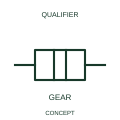

# Mechanical gear connection

A gear-connection indication identifies transmission through a gearing relationship.

[Canonical reference](https://eloragrid.ai/symbols/iec-mechanical-gear-connection) · [Structured record](../entries/iec-mechanical-gear-connection.json) · [All references](README.md)

Updated: 2026-10-27. Drawing use: Schematic. Reference families: IEC, Manufacturer.

Graphical convention: IEC. Mechanical gear connection.

## What it represents

A gear-connection indication identifies transmission through a gearing relationship. A gear relationship transfers motion through the documented gearing arrangement. It can relate an operating member to a switch, position device or driven mechanism.
The schematic identifies the relationship while a mechanical drawing supplies ratio and geometry. Avoid treating the gear connection mark as a numerical reduction ratio.

## How to read it

- State the driving/driven mechanism and any required ratio in the schedule.
- The symbol does not give a gear ratio, tooth geometry or mechanical rating.

## Drawing checklist

- Identify the associated device, circuit or diagram boundary.
- State the driving/driven mechanism and any required ratio in the schedule.
- Cross-reference the equipment data, terminal mapping or operating-state legend needed to interpret the form.

## Important distinction

The symbol does not give a gear ratio, tooth geometry or mechanical rating.

## Facts

- Reference scope: Specific public IEC-context family form
- Publisher reference token: Q021223 (Autodesk token; not a verified IEC database ID)
- Information added: State the driving/driven mechanism and any required ratio in the schedule.
- Preview: Independent educational concept; consult the publisher and applicable standard for the exact graphic

## Public references

- [Autodesk IEC-60617 preview: Mechanical coupling qualifiers](https://help.autodesk.com/cloudhelp/2021/ENU/AutoCAD-Electrical/files/GUID-F3E7DE9A-47D1-4C25-BBBE-6C07AA1B3033.htm) — Autodesk. Official public publisher family name and reference context; vendor identifiers and graphics are distinct from licensed IEC database content.

## Related references

- [Relay coil](relay-coil.md)
- [Normally open contact](normally-open-contact.md)

Original educational concept geometry, CC BY 4.0. Unitless; not a certified standards glyph or manufacturer footprint.

Elora-authored explanations are CC BY 4.0. Linked standards and manufacturer material retain their own rights. Confirm project requirements using primary sources.
