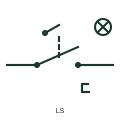

# IEC mechanical position-switch contact: 2 position switch normally open with detents and lamp

Mechanical position-switch contact form: 2 Position Switch Normally Open with Detents and Lamp.

[Canonical reference](https://eloragrid.ai/symbols/iec-mechanical-position-switch-contact-2-position-switch-normally-open-with-detents-and-lamp) · [Structured record](../entries/iec-mechanical-position-switch-contact-2-position-switch-normally-open-with-detents-and-lamp.json) · [All references](README.md)

Updated: 2026-10-28. Drawing use: Schematic. Reference families: IEC, Manufacturer.

Graphical convention: IEC. 2 Position Switch Normally Open with Detents and Lamp.

## What it represents

A mechanically operated position switch changes its contact state when travel, a cam or a lever reaches the documented operating condition. The actuator mark explains how movement reaches the switch; the electrical contact still has to be read in its stated unoperated position. This entry identifies the 2 position switch normally open with detents and lamp form in the publisher's IEC-context family.
A moving carriage may operate the switch near the end of travel, or an operator may move a multidirectional lever. Identify the actual direction or target position on the drawing and connect the switch tag to the corresponding mechanical detail. The normally-open designation starts with a non-conducting output or open contact in the documented reference condition; operation changes that state. The detent retains the lever position after actuation; a retained indication and a spring-return position input require different operating logic.
Detents retain an operating position and are different from a spring-return mechanism. The schematic does not supply operating travel, overtravel, contact force or a safety performance level; use the selected switch data for those properties.

## How to read it

- The normally-open designation starts with a non-conducting output or open contact in the documented reference condition; operation changes that state.
- The detent retains the lever position after actuation; a retained indication and a spring-return position input require different operating logic.
- Detents retain an operating position and are different from a spring-return mechanism. The schematic does not supply operating travel, overtravel, contact force or a safety performance level; use the selected switch data for those properties.

## Drawing checklist

- Name the position, movement or event that operates the switch.
- Show whether the mechanism returns or remains in a detent.
- Match terminals and contact state to the mechanical operating detail.

## Important distinction

This entry adds the 2 position switch normally open with detents and lamp detail to the broader mechanical position-switch contact family. Detents retain an operating position and are different from a spring-return mechanism. The schematic does not supply operating travel, overtravel, contact force or a safety performance level; use the selected switch data for those properties.

## Facts

- Drawing form: 2 Position Switch Normally Open with Detents and Lamp
- Public vendor block names: HLS11S78 / VLS11S78. Autodesk identifiers, not standards database IDs.
- Drawing purpose: mechanical position-switch contact
- Graphic scope: Independently authored educational illustration; not certified standard geometry, a terminal pinout or a product footprint.

## Public references

- [AutoCAD Electrical: Limit switches](https://help.autodesk.com/cloudhelp/2021/ENU/AutoCAD-Electrical/files/GUID-3CF4BE45-A302-4757-B5C9-C1AFF9BDC512.htm) — Autodesk. Public Limit Switches table explicitly lists HLS11S78 / VLS11S78 with this operating or connection form. Vendor graphics are linked, not copied.

## Related references

- [Normally-open limit switch](normally-open-limit-switch.md)
- [Normally-closed limit switch](normally-closed-limit-switch.md)
- [Roller-operated limit switch](roller-operated-limit-switch.md)

Original educational concept geometry, CC BY 4.0. Unitless; not a certified standards glyph or manufacturer footprint.

Elora-authored explanations are CC BY 4.0. Linked standards and manufacturer material retain their own rights. Confirm project requirements using primary sources.
