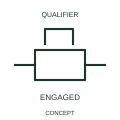

# Mechanical stop latch in engaged state

This form identifies an engaged stop-latch mechanism.

[Canonical reference](https://eloragrid.ai/symbols/iec-mechanical-stop-latch-in-engaged-state) · [Structured record](../entries/iec-mechanical-stop-latch-in-engaged-state.json) · [All references](README.md)

Updated: 2026-10-27. Drawing use: Schematic. Reference families: IEC, Manufacturer.

Graphical convention: IEC. Mechanical stop latch in engaged state.

## What it represents

This form identifies an engaged stop-latch mechanism. The state describes mechanical retention. The affected device can have separate electrical contacts reporting that position, so engagement is not equivalent to energisation.
State which movement is restrained and what documented release action changes the condition. Where feedback is used, cross-reference its actual contact rather than treating the latch mark as an electrical output.

## How to read it

- State which movement is restrained and what releases the latch.
- An engaged latch does not automatically indicate a circuit is energised.

## Drawing checklist

- Identify the associated device, circuit or diagram boundary.
- State which movement is restrained and what releases the latch.
- Cross-reference the equipment data, terminal mapping or operating-state legend needed to interpret the form.

## Important distinction

An engaged latch does not automatically indicate a circuit is energised.

## Facts

- Reference scope: Specific public IEC-context family form
- Publisher reference token: Q021210, Q021212 (Autodesk tokens; not verified IEC database IDs)
- Information added: State which movement is restrained and what releases the latch.
- Preview: Independent educational concept; consult the publisher and applicable standard for the exact graphic

## Public references

- [Autodesk IEC-60617 preview: Mechanical return and interlock qualifiers](https://help.autodesk.com/cloudhelp/2021/ENU/AutoCAD-Electrical/files/GUID-084BF99C-FD3E-4ECF-A86B-608EF93DF6E5.htm) — Autodesk. Official public publisher family name and reference context; vendor identifiers and graphics are distinct from licensed IEC database content.
- [Autodesk IEC-60617 preview: Latching-device qualifiers](https://help.autodesk.com/cloudhelp/2021/ENU/AutoCAD-Electrical/files/GUID-9FC7824E-1A3B-4B47-B157-590CB8AE62FC.htm) — Autodesk. Public alternate engaged/neutral latching-device tokens are consolidated with the matching mechanical state concept.

## Related references

- [Relay coil](relay-coil.md)
- [Normally open contact](normally-open-contact.md)

Original educational concept geometry, CC BY 4.0. Unitless; not a certified standards glyph or manufacturer footprint.

Elora-authored explanations are CC BY 4.0. Linked standards and manufacturer material retain their own rights. Confirm project requirements using primary sources.
