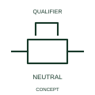

# Mechanical stop latch in neutral state

This form identifies the neutral state of the represented stop-latch mechanism.

[Canonical reference](https://eloragrid.ai/symbols/iec-mechanical-stop-latch-in-neutral-state) · [Structured record](../entries/iec-mechanical-stop-latch-in-neutral-state.json) · [All references](README.md)

Updated: 2026-10-27. Drawing use: Schematic. Reference families: IEC, Manufacturer.

Graphical convention: IEC. Mechanical stop latch in neutral state.

## What it represents

This form identifies the neutral state of the represented stop-latch mechanism. Neutral describes the represented retaining mechanism, not every electrical contact belonging to the assembly. A state table provides the relationship between latch condition and contact states.
Identify the associated mechanism and define the neutral condition in its operating sequence. Use separate contact and position references when those interfaces appear elsewhere in the schematic.

## How to read it

- Keep neutral and engaged states explicit in state or sequence documentation.
- Neutral is a mechanism state, not an assertion that every contact is open.

## Drawing checklist

- Identify the associated device, circuit or diagram boundary.
- Keep neutral and engaged states explicit in state or sequence documentation.
- Cross-reference the equipment data, terminal mapping or operating-state legend needed to interpret the form.

## Important distinction

Neutral is a mechanism state, not an assertion that every contact is open.

## Facts

- Reference scope: Specific public IEC-context family form
- Publisher reference token: Q021209, Q021213 (Autodesk tokens; not verified IEC database IDs)
- Information added: Keep neutral and engaged states explicit in state or sequence documentation.
- Preview: Independent educational concept; consult the publisher and applicable standard for the exact graphic

## Public references

- [Autodesk IEC-60617 preview: Mechanical return and interlock qualifiers](https://help.autodesk.com/cloudhelp/2021/ENU/AutoCAD-Electrical/files/GUID-084BF99C-FD3E-4ECF-A86B-608EF93DF6E5.htm) — Autodesk. Official public publisher family name and reference context; vendor identifiers and graphics are distinct from licensed IEC database content.
- [Autodesk IEC-60617 preview: Latching-device qualifiers](https://help.autodesk.com/cloudhelp/2021/ENU/AutoCAD-Electrical/files/GUID-9FC7824E-1A3B-4B47-B157-590CB8AE62FC.htm) — Autodesk. Public alternate engaged/neutral latching-device tokens are consolidated with the matching mechanical state concept.

## Related references

- [Relay coil](relay-coil.md)
- [Normally open contact](normally-open-contact.md)

Original educational concept geometry, CC BY 4.0. Unitless; not a certified standards glyph or manufacturer footprint.

Elora-authored explanations are CC BY 4.0. Linked standards and manufacturer material retain their own rights. Confirm project requirements using primary sources.
