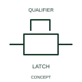

# Mechanical stop-latch indication

A stop-latch indication identifies a mechanically retained control position.

[Canonical reference](https://eloragrid.ai/symbols/iec-mechanical-stop-latch-indication) · [Structured record](../entries/iec-mechanical-stop-latch-indication.json) · [All references](README.md)

Updated: 2026-10-27. Drawing use: Schematic. Reference families: IEC, Manufacturer.

Graphical convention: IEC. Mechanical stop-latch indication.

## What it represents

A stop-latch indication identifies a mechanically retained control position. A stop latch mechanically retains a position until its specified release action occurs. The mechanism state can be maintained without an electrical holding coil remaining energised.
Identify the retained movement and the release/reset path. If position is reported electrically, cross-reference the feedback contact rather than assuming the latch indication supplies that signal.

## How to read it

- Specify the release action and the controlled device relationship.
- A stop latch is distinct from a timer holding a circuit electrically.

## Drawing checklist

- Identify the associated device, circuit or diagram boundary.
- Specify the release action and the controlled device relationship.
- Cross-reference the equipment data, terminal mapping or operating-state legend needed to interpret the form.

## Important distinction

A stop latch is distinct from a timer holding a circuit electrically.

## Facts

- Reference scope: Specific public IEC-context family form
- Publisher reference token: Q021208 (Autodesk token; not a verified IEC database ID)
- Information added: Specify the release action and the controlled device relationship.
- Preview: Independent educational concept; consult the publisher and applicable standard for the exact graphic

## Public references

- [Autodesk IEC-60617 preview: Mechanical return and interlock qualifiers](https://help.autodesk.com/cloudhelp/2021/ENU/AutoCAD-Electrical/files/GUID-084BF99C-FD3E-4ECF-A86B-608EF93DF6E5.htm) — Autodesk. Official public publisher family name and reference context; vendor identifiers and graphics are distinct from licensed IEC database content.

## Related references

- [Relay coil](relay-coil.md)
- [Normally open contact](normally-open-contact.md)

Original educational concept geometry, CC BY 4.0. Unitless; not a certified standards glyph or manufacturer footprint.

Elora-authored explanations are CC BY 4.0. Linked standards and manufacturer material retain their own rights. Confirm project requirements using primary sources.
