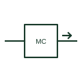

# Media converter symbol

Network symbol for a media converter linking copper Ethernet to optical fibre, drawn as a box with electrical and optical ports.

[Canonical reference](https://eloragrid.ai/symbols/iec-media-converter-symbol) · [Structured record](../entries/iec-media-converter-symbol.json) · [All references](README.md)

Updated: 2026-10-28. Drawing use: Schematic. Reference families: IEC.

## What it represents

A media converter changes the physical medium of an Ethernet link from copper twisted pair to optical fibre, without routing or switching. Diagrams draw a box with a copper port on one side and a fibre port, often marked with a light arrow, on the other.
On electrical and control drawings, media converters appear where a device with copper Ethernet must reach a remote location or cross an area with earth potential differences. Their power supply and mounting in the panel are shown on the schematic. The symbol does not show the fibre type or wavelength. The fibre port must match the cable.

## How to read it

- Identify which side is fibre.
- Check power supply.

## Drawing checklist

- State fibre type and connector.
- Show power supply.
- Label link ends.

## Important distinction

A network switch forwards traffic between many ports; a media converter only changes the medium on one link.

## Facts

- Function: Medium conversion only
- Ports: One copper, one fibre
- Preview: Independent educational concept; plan symbols for this device vary between legends, so read the project key

## Public references

- [Industrial Ethernet to fibre media converters](https://www.westermo.com/products/converters/ethernet-media-converters) — Westermo. Public product family page describing copper Ethernet to fibre conversion.
- [Autodesk IEC-60617 preview: Propagation and signal-flow qualifiers](https://help.autodesk.com/cloudhelp/2021/ENU/AutoCAD-Electrical/files/GUID-1C0C7AE2-F703-4283-BCB1-3E0B30882715.htm) — Autodesk. Public IEC-oriented propagation and signal-flow qualifiers used on communication symbols.

## Related references

- [Fibre-optic link symbol](iec-fibre-optic-link-symbol.md)
- [Ethernet physical-layer transceiver](ethernet-phy.md)
- [Network switch symbol](iec-network-switch-plan-symbol.md)

Original educational concept geometry, CC BY 4.0. Unitless; not a certified standards glyph or manufacturer footprint.

Elora-authored explanations are CC BY 4.0. Linked standards and manufacturer material retain their own rights. Confirm project requirements using primary sources.
