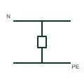

# Neutral-to-earth link

The single link bonding the neutral bar to the earth bar at the point where a TN-C-S supply splits into N and PE.

[Canonical reference](https://eloragrid.ai/symbols/iec-men-link) · [Structured record](../entries/iec-men-link.json) · [All references](README.md)

Updated: 2026-10-28. Drawing use: SLD, Schematic. Reference families: IEC.

Graphical convention: IEC. Neutral to earth bonding link.

## What it represents

The neutral-to-earth link connects the neutral and earth bars at one point, normally the main switchboard. In Australian and New Zealand practice it is the MEN link, and in other TN-C-S schemes it is the point where the incoming PEN is split. It provides the low impedance path that lets earth faults operate overcurrent devices.
There must be only one such link in an installation section. A second neutral to earth bond downstream creates parallel neutral current in earthing conductors and can defeat residual current devices. The symbol does not show the conductor size of the link, which local rules set.

## How to read it

- Confirm there is only one neutral to earth link in the installation section.
- Check RCD-protected circuits downstream for unintended bonds.

## Drawing checklist

- Show the link at the main switchboard.
- State link conductor size.
- Avoid any downstream neutral to earth bond.

## Important distinction

The neutral-to-earth link bonds N and PE in service; the earth test link is opened only to test the electrode.

## Facts

- Graphic cue: Link between neutral bar and earth bar
- Scheme context: TN-C-S and MEN systems
- Rule: One link per installation section
- Preview: Original educational illustration; consult the publisher and applicable standard for the exact graphic

## Public references

- [Definition of standardised earthing schemes](https://www.electrical-installation.org/enwiki/Definition_of_standardised_earthing_schemes) — Schneider Electric, Electrical Installation Guide. Public installation-guide definitions of TN-C-S schemes and PEN separation.
- [Earthing connections](https://www.electrical-installation.org/enwiki/Earthing_connections) — Schneider Electric, Electrical Installation Guide. Public installation-guide earthing connection elements.

## Related references

- [PEN conductor mark](iec-pen-conductor-mark.md)
- [Main earthing terminal](iec-main-earthing-terminal.md)
- [Residual-current circuit breaker](residual-current-circuit-breaker.md)

Original educational concept geometry, CC BY 4.0. Unitless; not a certified standards glyph or manufacturer footprint.

Elora-authored explanations are CC BY 4.0. Linked standards and manufacturer material retain their own rights. Confirm project requirements using primary sources.
