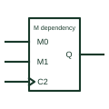

# IEC mode dependency (M)

Dependency label Mm used to show operating modes; affected inputs and outputs act only in the selected mode.

[Canonical reference](https://eloragrid.ai/symbols/iec-mode-dependency-m) · [Structured record](../entries/iec-mode-dependency-m.json) · [All references](README.md)

Updated: 2026-10-28. Drawing use: Schematic. Reference families: IEC, Manufacturer.

Graphical convention: IEC. Mode inputs labelled Mm, often produced by binary grouping, with affected terminals labelled m.

## What it represents

M dependency is used where a device has several operating modes. When an Mm input is at its internal 1 state, inputs and outputs labelled m have their normal effect; otherwise they are disabled. Mode inputs are often produced from two select lines by binary grouping, giving M0 to M3.
Universal shift registers and up/down counters are typical users. On the symbol, a label such as 1,4D means the input acts as data only in mode 1 and with control 4. Reading these compound labels from left to right gives the order of conditions.
The notation does not define what happens during a mode change. Any restrictions on changing mode while clocking are device-specific.

## How to read it

- Decode the mode inputs before reading other labels.
- Compound labels list affecting numbers separated by commas.

## Drawing checklist

- Show the mode-select inputs and their binary grouping.
- Label affected terminals with the mode numbers.
- Tabulate the modes in a note if the symbol is complex.

## Important distinction

A (address) dependency selects among arrays of identical elements; M selects operating modes of one element.

## Facts

- Affecting input at 1: Permits action (mode selected)
- Typical device: Universal shift register
- Artwork scope: Original educational illustration; consult the applicable standard and the selected device documentation for the exact graphic

## Public references

- [Overview of IEEE Standard 91-1984: explanation of logic symbols (SDYZ001A)](https://www.ti.com/lit/ml/sdyz001a/sdyz001a.pdf) — Texas Instruments. M (mode) dependency affecting inputs and outputs.

## Related references

- [IEC bidirectional (universal) shift register](iec-bidirectional-shift-register.md)
- [IEC up/down counter](iec-up-down-counter.md)
- [IEC address dependency (A)](iec-address-dependency-a.md)

Original educational concept geometry, CC BY 4.0. Unitless; not a certified standards glyph or manufacturer footprint.

Elora-authored explanations are CC BY 4.0. Linked standards and manufacturer material retain their own rights. Confirm project requirements using primary sources.
