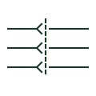

# Multi-pole plug and socket

A plug and socket pair drawn with several poles side by side, showing a multi-way connector carrying several conductors.

[Canonical reference](https://eloragrid.ai/symbols/iec-multi-pole-plug-and-socket) · [Structured record](../entries/iec-multi-pole-plug-and-socket.json) · [All references](README.md)

Updated: 2026-10-28. Drawing use: Schematic. Reference families: IEC.

Graphical convention: IEC. Multi-pole plug and socket, multi-line form.

## What it represents

The multi-pole form draws each contact of a connector as a pin and socket pair, grouped together and tied by a common outline or mechanical link to show they belong to one connector body. It is used for machine harness connectors, removable control modules and multi-pin field connectors on instruments.
The multi-line form shows every pin, which makes it suitable for wiring diagrams where pin numbers matter. It does not show keying, coding or the connector series, which prevent mismating and must be stated in text. Unused pins are often omitted, so the pin count drawn may be less than the connector size.

## How to read it

- Match pin numbers on the drawing to the connector insert layout.
- Check whether unused pins are omitted.

## Drawing checklist

- Number every pin drawn.
- State connector series and keying.
- Identify which half is fixed and which is free.

## Important distinction

A multi-pole plug and socket draws each pin; the one-line connector representation shows the whole connector as one mark.

## Facts

- Graphic cue: Several pin and socket pairs grouped by a common outline
- Publisher family: Connectors - No Wirenumber Changes (Autodesk IEC-60617 preview)
- Preview: Original educational illustration; consult the publisher and applicable standard for the exact graphic

## Public references

- [AutoCAD Electrical: Connectors](https://help.autodesk.com/cloudhelp/2021/ENU/AutoCAD-Electrical/files/GUID-7175D293-9F4C-485C-8E2D-DE684820D53B.htm) — Autodesk. Public IEC-oriented preview of plug and jack connector forms.
- [IEC-60617 symbol preview directory](https://help.autodesk.com/cloudhelp/2021/ENU/AutoCAD-Electrical/files/GUID-7871E6EF-24D5-467E-9B74-321FEDC9DFDA.htm) — Autodesk. Public directory of IEC-oriented symbol families.

## Related references

- [Plug and socket connector pair](plug-and-socket-connector-pair.md)
- [One-line connector representation](iec-one-line-connector-representation.md)
- [Additional connector pin](iec-additional-connector-pin.md)

Original educational concept geometry, CC BY 4.0. Unitless; not a certified standards glyph or manufacturer footprint.

Elora-authored explanations are CC BY 4.0. Linked standards and manufacturer material retain their own rights. Confirm project requirements using primary sources.
