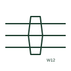

# Conductors within one cable

An outline or loop drawn across several conductor lines to show that they are cores of the same cable.

[Canonical reference](https://eloragrid.ai/symbols/iec-multicore-cable-grouping) · [Structured record](../entries/iec-multicore-cable-grouping.json) · [All references](README.md)

Updated: 2026-10-28. Drawing use: Schematic. Reference families: IEC.

Graphical convention: IEC. Cable core grouping form.

## What it represents

On multi-line schematics each core is drawn as a separate line, which hides the fact that several of them share one sheath. A grouping outline drawn across those lines tells the reader they are cores of one cable. It is typically paired with a cable tag so that the cores can be traced to the cable schedule.
The outline implies no screen and no particular core count beyond the lines it crosses. Spare cores are often not drawn, so the cable may have more cores than the outline encloses. Cores from one cable may also be split across several sheets, each with its own grouping mark and the same cable tag.

## How to read it

- Read the cable tag beside the grouping outline.
- Expect spare cores that are not drawn.

## Drawing checklist

- Tag every grouping outline with the cable number.
- Use the same tag on every sheet the cable appears on.
- Record spare cores in the cable schedule.

## Important distinction

A grouping outline shows shared sheath only; a screen outline shows a conductive shield around the cores.

## Facts

- Graphic cue: Ellipse or loop crossing several parallel conductors
- Does not show: Screening, spare cores or core colours
- Preview: Original educational illustration; consult the publisher and applicable standard for the exact graphic

## Public references

- [Autodesk IEC-60617 preview: Cable identification and twisted-pair annotation](https://help.autodesk.com/cloudhelp/2021/ENU/AutoCAD-Electrical/files/GUID-37A08C35-43A3-484D-B0EB-0BBCBC4BE709.htm) — Autodesk. Public IEC-60617 preview family for cable markers used with core groupings.
- [IEC-60617 symbol preview directory](https://help.autodesk.com/cloudhelp/2021/ENU/AutoCAD-Electrical/files/GUID-7871E6EF-24D5-467E-9B74-321FEDC9DFDA.htm) — Autodesk. Public directory of IEC-oriented symbol families.

## Related references

- [Cable identification marker](iec-cable-identification-marker.md)
- [Additional cable-core marker](iec-additional-cable-core-marker.md)
- [Screened multi-conductor cable](iec-screened-multi-conductor-cable.md)

Original educational concept geometry, CC BY 4.0. Unitless; not a certified standards glyph or manufacturer footprint.

Elora-authored explanations are CC BY 4.0. Linked standards and manufacturer material retain their own rights. Confirm project requirements using primary sources.
