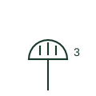

# Multiple socket outlet

Plan mark for a group of socket outlets on one plate, shown by a gang number or stacked outlet strokes.

[Canonical reference](https://eloragrid.ai/symbols/iec-multiple-socket-outlet) · [Structured record](../entries/iec-multiple-socket-outlet.json) · [All references](README.md)

Updated: 2026-10-28. Drawing use: GA. Reference families: IEC.

Graphical convention: IEC. Multiple socket outlet.

## What it represents

A multiple socket outlet groups two, three or four outlets in one accessory or box. IEC-style plans usually draw a single outlet form with the number of outlets written beside it, or with short parallel strokes on the outlet, instead of drawing each outlet separately.
The number is important for take-off and for load estimates. A desk position shown as a 3-gang outlet with data outlets beside it is a common office pattern; the reader should count the gang number, not the symbol, when scheduling accessories.
The library already lists a duplex receptacle form from a schematic CAD family. This plan mark is the architectural counting form; it does not say whether each outlet is separately switched or whether they share one circuit.

## How to read it

- Read the gang number; the symbol may look identical to a single outlet without it.
- Check whether switches are integral to each gang.

## Drawing checklist

- Write the gang number on or beside the symbol.
- State switching per gang if relevant.
- Tag the circuit.

## Important distinction

The duplex receptacle form in schematic libraries shows two outlets graphically; this plan mark counts outlets with a numeral.

## Facts

- Count method: Numeral beside the outlet form
- Take-off note: Count accessories by gang, not by symbol
- Exact standard graphic: Not reproduced here; confirm the form against IEC 60617 and the project legend

## Public references

- [IEC graphical symbols for diagrams](https://tc3.iec.ch/tc-activity/graphical-symbols-for-diagrams/) — IEC. IEC committee context for graphical symbols used in diagrams and installation documents; not a source of reproduced artwork.
- [Autodesk IEC-60617 preview: Single and duplex power-receptacle forms](https://help.autodesk.com/cloudhelp/2021/ENU/AutoCAD-Electrical/files/GUID-7DAEDB03-74FC-47A2-9C50-9164297AA5A3.htm) — Autodesk. Public receptacle family in an IEC-oriented CAD library, useful for comparing schematic receptacle forms with plan marks.

## Related references

- [Duplex power receptacle](iec-duplex-power-receptacle.md)
- [Socket outlet with protective earth contact](iec-socket-outlet-with-protective-contact.md)
- [Floor box outlet](iec-floor-box-outlet.md)

Original educational concept geometry, CC BY 4.0. Unitless; not a certified standards glyph or manufacturer footprint.

Elora-authored explanations are CC BY 4.0. Linked standards and manufacturer material retain their own rights. Confirm project requirements using primary sources.
