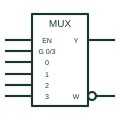

# IEC multiplexer (MUX)

IEC MUX element whose select inputs, grouped with G dependency, pick which data input reaches the output.

[Canonical reference](https://eloragrid.ai/symbols/iec-multiplexer) · [Structured record](../entries/iec-multiplexer.json) · [All references](README.md)

Updated: 2026-10-28. Drawing use: Schematic. Reference families: IEC, Manufacturer.

Graphical convention: IEC. Rectangular element with MUX qualifier and select inputs using G dependency.

## What it represents

The IEC multiplexer carries the MUX qualifier. Select inputs are drawn with a binary grouping bracket producing G0 to Gn, and each data input is labelled with the matching number, so the data input whose number equals the select value is ANDed through to the output. An EN input, often active low, enables the whole element.
Multiplexers on control drawings route one of several signals to a shared output, for example selecting a measurement channel or an operating mode source. The binary grouping makes the select range clear without drawing a decoder.
The symbol does not state the switching time or whether outputs glitch during a select change. Those are device timing considerations.

## How to read it

- Read the binary grouping to find the select range.
- Each data input number matches a G value.

## Drawing checklist

- Show select inputs with a binary grouping bracket.
- Number data inputs to match.
- Mark EN polarity.

## Important distinction

The analogue multiplexer passes analogue levels through switches; the logic MUX passes logic states.

## Facts

- Qualifier: MUX
- Select notation: Binary grouping with G dependency
- Artwork scope: Original educational illustration; consult the applicable standard and the selected device documentation for the exact graphic

## Public references

- [Overview of IEEE Standard 91-1984: explanation of logic symbols (SDYZ001A)](https://www.ti.com/lit/ml/sdyz001a/sdyz001a.pdf) — Texas Instruments. MUX qualifier, G dependency and binary grouping.
- [SN74HC151 — digital multiplexing](https://www.ti.com/lit/ds/symlink/sn74hc151.pdf) — Texas Instruments. Digital multiplexer documentation.

## Related references

- [Digital multiplexer](digital-multiplexer.md)
- [IEC AND dependency (G)](iec-and-dependency-g.md)
- [Analogue multiplexer](analog-multiplexer.md)

Original educational concept geometry, CC BY 4.0. Unitless; not a certified standards glyph or manufacturer footprint.

Elora-authored explanations are CC BY 4.0. Linked standards and manufacturer material retain their own rights. Confirm project requirements using primary sources.
