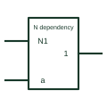

# IEC negate dependency (N)

Dependency label Nm: when the N input is active, affected terminals are complemented.

[Canonical reference](https://eloragrid.ai/symbols/iec-negate-dependency-n) · [Structured record](../entries/iec-negate-dependency-n.json) · [All references](README.md)

Updated: 2026-10-28. Drawing use: Schematic. Reference families: IEC, Manufacturer.

Graphical convention: IEC. Affecting input labelled Nm with affected terminals labelled m.

## What it represents

N dependency is the negate or exclusive-OR relationship. When the Nm affecting input is at its internal 1 state, each affected input or output labelled m is complemented. At 0 it has no effect. The result is a controllable inverter folded into the device symbol.
This notation appears on devices with selectable output polarity, such as programmable inverting or non-inverting buffers. Reading the N label tells the drafter that the same pin can produce either sense depending on the control input.
The label does not indicate when the polarity may be changed during operation. That is a matter of device timing and system design.

## How to read it

- An active N input inverts every terminal labelled with its number.
- Check the state of the N control in each operating mode.

## Drawing checklist

- Label the polarity control input as Nm.
- Mark affected terminals with m.
- State the default polarity in the sheet notes.

## Important distinction

Fixed output negation is a circle or triangle; N dependency makes the negation switchable.

## Facts

- Affecting input at 1: Complements state
- Affecting input at 0: No effect
- Artwork scope: Original educational illustration; consult the applicable standard and the selected device documentation for the exact graphic

## Public references

- [Overview of IEEE Standard 91-1984: explanation of logic symbols (SDYZ001A)](https://www.ti.com/lit/ml/sdyz001a/sdyz001a.pdf) — Texas Instruments. N (negate) dependency description.

## Related references

- [IEC OR dependency (V)](iec-or-dependency-v.md)
- [IEC exclusive-OR gate (rectangular form)](iec-xor-gate.md)
- [IEC logic negation at output](iec-logic-output-negation.md)

Original educational concept geometry, CC BY 4.0. Unitless; not a certified standards glyph or manufacturer footprint.

Elora-authored explanations are CC BY 4.0. Linked standards and manufacturer material retain their own rights. Confirm project requirements using primary sources.
