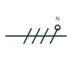

# Neutral conductor mark

A mark on a single-line conductor group identifying which conductor is the neutral, often drawn as a small circle on a stroke.

[Canonical reference](https://eloragrid.ai/symbols/iec-neutral-conductor-mark) · [Structured record](../entries/iec-neutral-conductor-mark.json) · [All references](README.md)

Updated: 2026-10-28. Drawing use: SLD, Schematic. Reference families: IEC.

Graphical convention: IEC. Neutral conductor identification on a conductor group.

## What it represents

When a single line represents a group of conductors, one of them can be identified as the neutral with a distinct mark on its stroke, together with the letter N where clarity requires. This lets a single-line diagram tell a three-phase three-wire feeder from a three-phase four-wire feeder without expanding to multi-line form.
The mark identifies the neutral but does not say whether the neutral is fully rated, reduced or oversized for harmonic loading. It also does not show where the neutral is earthed. System earthing is a separate decision shown at the source, for example a star point to earth connection or a neutral earthing resistor.

## How to read it

- Check whether the feeder carries a neutral before assuming four-wire loads are supported.
- Look at the source to see how the neutral is earthed.

## Drawing checklist

- Mark the neutral on each four-wire feeder.
- State neutral sizing where it differs from phase conductors.
- Show neutral switching or links where the scheme requires them.

## Important distinction

A neutral mark identifies the N conductor; a PEN mark identifies a combined neutral and protective conductor with different switching rules.

## Facts

- Graphic cue: Distinct tick or small circle on one stroke of a conductor group
- Letter code: N
- Preview: Original educational illustration; consult the publisher and applicable standard for the exact graphic

## Public references

- [Definition of standardised earthing schemes](https://www.electrical-installation.org/enwiki/Definition_of_standardised_earthing_schemes) — Schneider Electric, Electrical Installation Guide. Public installation-guide definitions of earthing schemes and the role of the neutral conductor.
- [IEC-60617 symbol preview directory](https://help.autodesk.com/cloudhelp/2021/ENU/AutoCAD-Electrical/files/GUID-7871E6EF-24D5-467E-9B74-321FEDC9DFDA.htm) — Autodesk. Public directory of IEC-oriented symbol families.

## Related references

- [PEN conductor mark](iec-pen-conductor-mark.md)
- [Protective conductor mark](iec-protective-conductor-mark.md)
- [Star winding with accessible neutral](star-winding-with-accessible-neutral.md)

Original educational concept geometry, CC BY 4.0. Unitless; not a certified standards glyph or manufacturer footprint.

Elora-authored explanations are CC BY 4.0. Linked standards and manufacturer material retain their own rights. Confirm project requirements using primary sources.
