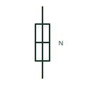

# Neutral link, closed

A removable link in the neutral conductor shown in its closed position, allowing the neutral to be opened for testing.

[Canonical reference](https://eloragrid.ai/symbols/iec-neutral-link-closed) · [Structured record](../entries/iec-neutral-link-closed.json) · [All references](README.md)

Updated: 2026-10-28. Drawing use: SLD, Schematic. Reference families: IEC, Manufacturer.

Graphical convention: IEC. Neutral link, closed.

## What it represents

A neutral link is a bolted or plug-in link in the neutral conductor, often mounted in a fuse carrier style holder alongside phase fuses. It allows the neutral of a circuit to be disconnected for insulation testing or fault finding without disturbing other circuits on the neutral bar. The closed form shows its normal service state.
The symbol is not a switch and the link should not be opened under load. It does not provide overcurrent protection; the fuse-like holder can mislead readers into treating it as a neutral fuse. Rules on whether the neutral may be separately disconnected differ between earthing schemes.

## How to read it

- Do not read the holder as a fuse.
- Confirm the link is opened only with the circuit isolated.

## Drawing checklist

- Label the link with its circuit number.
- Show it in its normal closed state.
- Check scheme rules for neutral disconnection.

## Important distinction

A closed neutral link is a removable connection; a neutral fuse would be a protective device and is generally not permitted.

## Facts

- Graphic cue: Fuse-carrier style link drawn bridged
- Publisher form: Neutral Link - Closed (HFU1NLC Autodesk identifier)
- Preview: Original educational illustration; consult the publisher and applicable standard for the exact graphic

## Public references

- [Fuse and neutral-link symbols](https://help.autodesk.com/cloudhelp/2021/ENU/AutoCAD-Electrical/files/GUID-E540AE83-CEE1-4CA9-B43C-B19004025EAA.htm) — Autodesk. Public IEC-oriented preview listing neutral link closed and open forms.
- [Definition of standardised earthing schemes](https://www.electrical-installation.org/enwiki/Definition_of_standardised_earthing_schemes) — Schneider Electric, Electrical Installation Guide. Public installation-guide definitions of the neutral's role in earthing schemes.

## Related references

- [Neutral link, open](iec-neutral-link-open.md)
- [Neutral conductor mark](iec-neutral-conductor-mark.md)
- [Fuse](fuse.md)

Original educational concept geometry, CC BY 4.0. Unitless; not a certified standards glyph or manufacturer footprint.

Elora-authored explanations are CC BY 4.0. Linked standards and manufacturer material retain their own rights. Confirm project requirements using primary sources.
