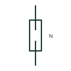

# Neutral link, open

A neutral link drawn removed or open, showing the neutral conductor disconnected at that point.

[Canonical reference](https://eloragrid.ai/symbols/iec-neutral-link-open) · [Structured record](../entries/iec-neutral-link-open.json) · [All references](README.md)

Updated: 2026-10-28. Drawing use: SLD, Schematic. Reference families: IEC, Manufacturer.

Graphical convention: IEC. Neutral link, open.

## What it represents

The open neutral link shows the link withdrawn so that the neutral is disconnected. Drawings use it where a circuit is normally run with the neutral open, for example to isolate a spare or to segregate a neutral during a changeover, and on test procedures that show the link removed.
An open neutral on a live four-wire circuit can cause severe overvoltage on single-phase loads, so an open link in normal service needs a clear reason on the drawing. The symbol says nothing about the phase conductors, which may still be energised.

## How to read it

- Ask why the neutral is shown open in service.
- Check that phases are also isolated before working.

## Drawing checklist

- Note the reason the link is open.
- Show phase isolation state alongside.
- Label the link with its circuit number.

## Important distinction

An open neutral link is disconnected; the closed form shows normal continuity.

## Facts

- Graphic cue: Fuse-carrier style link with the bridge missing
- Publisher form: Neutral Link - Open (HFU1NLO Autodesk identifier)
- Preview: Original educational illustration; consult the publisher and applicable standard for the exact graphic

## Public references

- [Fuse and neutral-link symbols](https://help.autodesk.com/cloudhelp/2021/ENU/AutoCAD-Electrical/files/GUID-E540AE83-CEE1-4CA9-B43C-B19004025EAA.htm) — Autodesk. Public IEC-oriented preview listing neutral link closed and open forms.
- [Definition of standardised earthing schemes](https://www.electrical-installation.org/enwiki/Definition_of_standardised_earthing_schemes) — Schneider Electric, Electrical Installation Guide. Public installation-guide definitions of the neutral's role in earthing schemes.

## Related references

- [Neutral link, closed](iec-neutral-link-closed.md)
- [Neutral conductor mark](iec-neutral-conductor-mark.md)
- [Disconnect terminal block](disconnect-terminal-block.md)

Original educational concept geometry, CC BY 4.0. Unitless; not a certified standards glyph or manufacturer footprint.

Elora-authored explanations are CC BY 4.0. Linked standards and manufacturer material retain their own rights. Confirm project requirements using primary sources.
