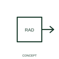

# Non-ionising radiation qualifier

This qualifier identifies the publisher's non-ionising radiation family, with the radiation role stated in the device description.

[Canonical reference](https://eloragrid.ai/symbols/iec-non-ionising-radiation-qualifier) · [Structured record](../entries/iec-non-ionising-radiation-qualifier.json) · [All references](README.md)

Updated: 2026-10-27. Drawing use: Schematic. Reference families: IEC, Manufacturer.

Graphical convention: IEC. Non-ionising radiation qualifier.

## What it represents

This qualifier identifies the publisher's non-ionising radiation family, with the radiation role stated in the device description.
Describe the actual emitter or detector rather than relying on the qualifier alone.
Radiation type and signal direction need separate interpretation.

## How to read it

- Describe the actual emitter or detector rather than relying on the qualifier alone.
- Radiation type and signal direction need separate interpretation.

## Drawing checklist

- Identify the associated device, circuit or diagram boundary.
- Describe the actual emitter or detector rather than relying on the qualifier alone.
- Cross-reference the equipment data, terminal mapping or operating-state legend needed to interpret the form.

## Important distinction

Radiation type and signal direction need separate interpretation.

## Facts

- Reference scope: Specific public IEC-context family form
- Publisher reference token: Q020901, Q020902 (Autodesk token; not a verified IEC database ID)
- Information added: Describe the actual emitter or detector rather than relying on the qualifier alone.
- Preview: Independent educational concept; consult the publisher and applicable standard for the exact graphic

## Public references

- [Autodesk IEC-60617 preview: Radiation qualifiers](https://help.autodesk.com/cloudhelp/2021/ENU/AutoCAD-Electrical/files/GUID-EABC81B4-549D-49C9-A0F5-086DD204A689.htm) — Autodesk. Official public publisher family name and reference context; vendor identifiers and graphics are distinct from licensed IEC database content.

## Related references

- [Power converter / inverter](power-converter.md)
- [Generic electrical load](generic-electrical-load.md)

Original educational concept geometry, CC BY 4.0. Unitless; not a certified standards glyph or manufacturer footprint.

Elora-authored explanations are CC BY 4.0. Linked standards and manufacturer material retain their own rights. Confirm project requirements using primary sources.
