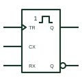

# IEC non-retriggerable monostable

IEC monostable marked with 1 and a single pulse: a trigger during the output pulse is ignored.

[Canonical reference](https://eloragrid.ai/symbols/iec-non-retriggerable-monostable) · [Structured record](../entries/iec-non-retriggerable-monostable.json) · [All references](README.md)

Updated: 2026-10-28. Drawing use: Schematic. Reference families: IEC, Manufacturer.

Graphical convention: IEC. Rectangular element with the 1 and single-pulse qualifier.

## What it represents

The non-retriggerable monostable produces one output pulse of fixed duration when triggered. Further triggers during that pulse have no effect. IEC drawings show the qualifier 1 with a single pulse shape inside the outline, and timing component connections are shown as non-logic inputs.
These elements are used to stretch short events into pulses long enough to be seen by slower logic, or to produce a fixed-width command. The external resistor and capacitor that set the pulse width should be drawn next to the element and the nominal width stated.
Pulse width tolerance depends on the timing components and the device. The symbol shows the behaviour, not the accuracy.

## How to read it

- Retriggers during the pulse are ignored.
- Find the timing resistor and capacitor connections.

## Drawing checklist

- Show the single-pulse qualifier.
- Draw the timing components and state the nominal width.
- Mark trigger input edge sense.

## Important distinction

The retriggerable monostable extends its pulse on each new trigger and is drawn without the 1.

## Facts

- Retrigger behaviour: Ignored during pulse
- Example device: Dual monostable multivibrators with Schmitt-trigger inputs
- Artwork scope: Original educational illustration; consult the applicable standard and the selected device documentation for the exact graphic

## Public references

- [Overview of IEEE Standard 91-1984: explanation of logic symbols (SDYZ001A)](https://www.ti.com/lit/ml/sdyz001a/sdyz001a.pdf) — Texas Instruments. Lists the nonretriggerable monostable general qualifier.
- [SN74LS221 dual monostable multivibrators with Schmitt-trigger inputs](https://www.ti.com/lit/ds/symlink/sn74ls221.pdf) — Texas Instruments. Manufacturer monostable multivibrator documentation.

## Related references

- [IEC retriggerable monostable](iec-retriggerable-monostable.md)
- [Retriggerable monostable](retriggerable-monostable.md)
- [IEC astable element](iec-astable-element.md)

Original educational concept geometry, CC BY 4.0. Unitless; not a certified standards glyph or manufacturer footprint.

Elora-authored explanations are CC BY 4.0. Linked standards and manufacturer material retain their own rights. Confirm project requirements using primary sources.
