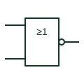

# IEC NOR gate (rectangular form)

IEC ≥1 element with a negated output; the output is active only when none of the inputs are active.

[Canonical reference](https://eloragrid.ai/symbols/iec-nor-gate) · [Structured record](../entries/iec-nor-gate.json) · [All references](README.md)

Updated: 2026-10-28. Drawing use: Schematic. Reference families: IEC, Manufacturer.

Graphical convention: IEC. ≥1 rectangular element with output negation circle.

## What it represents

The IEC NOR element is drawn as the ≥1 OR box with a negation circle at the output. Its output is at the external 1 state only when every input is inactive, which makes it a natural way to show an all-healthy or all-clear permissive on a logic sheet.
Interlock diagrams sometimes use the NOR element to produce a ready signal from a list of blocking conditions. The reader should check whether the blocking inputs are themselves negated, because a double negation can turn the function back into an AND of healthy signals.
As with all combinative IEC elements, the drawing says nothing about the response time or the electrical output stage. A NOR used in a safety function must also be traced to its implementing device to confirm the safety rating.

## How to read it

- Count negations along the path; NOR with negated inputs is an AND of the uncomplemented signals.
- Confirm which external level corresponds to the active state.

## Drawing checklist

- Place the negation mark at the output edge.
- Label each blocking input.
- Reference the implementing hardware or program block.

## Important distinction

A ≥1 element without the output circle is a plain OR; the circle is the only difference.

## Facts

- Qualifier: ≥1 plus output negation
- Common reading: Output active when all inputs inactive
- Artwork scope: Original educational illustration; consult the applicable standard and the selected device documentation for the exact graphic

## Public references

- [Overview of IEEE Standard 91-1984: explanation of logic symbols (SDYZ001A)](https://www.ti.com/lit/ml/sdyz001a/sdyz001a.pdf) — Texas Instruments. Rectangular OR qualifier and output negation.
- [SN74HC02 — NOR gate logic](https://www.ti.com/lit/ds/symlink/sn74hc02.pdf) — Texas Instruments. Manufacturer NOR gate documentation.

## Related references

- [NOR gate](logic-nor-gate.md)
- [IEC OR gate (rectangular form)](iec-or-gate.md)
- [IEC logic negation at output](iec-logic-output-negation.md)

Original educational concept geometry, CC BY 4.0. Unitless; not a certified standards glyph or manufacturer footprint.

Elora-authored explanations are CC BY 4.0. Linked standards and manufacturer material retain their own rights. Confirm project requirements using primary sources.
