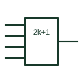

# IEC odd-parity element

Element marked 2k+1 that is active when an odd number of inputs are active, as used for parity.

[Canonical reference](https://eloragrid.ai/symbols/iec-odd-parity-element) · [Structured record](../entries/iec-odd-parity-element.json) · [All references](README.md)

Updated: 2026-10-28. Drawing use: Schematic. Reference families: IEC, Manufacturer.

Graphical convention: IEC. Rectangular element with the 2k+1 general qualifier.

## What it represents

The 2k+1 qualifier means the output is active when an odd number of inputs are active. It is what a cascade of two-input exclusive-OR gates actually computes, and it is the correct IEC qualifier for an odd-parity tree drawn as a single element.
Drafters converting older drawings sometimes mark a multi-input parity tree as =1. That is wrong under the IEC meaning, because =1 requires exactly one active input. Replacing it with 2k+1 removes the ambiguity.
The element does not indicate the number of data bits on its own; show the full input set or a grouped bus with its width.

## How to read it

- Do not read 2k+1 as exactly one active.
- Check whether the result is used as odd or even parity downstream.

## Drawing checklist

- Use 2k+1 for multi-input parity trees.
- State the word width.
- Reference the parity convention used by the protocol or memory.

## Important distinction

The =1 element gives the same result only for two inputs.

## Facts

- Qualifier: 2k+1 (odd number active)
- Two-input equivalent: Exclusive-OR
- Artwork scope: Original educational illustration; consult the applicable standard and the selected device documentation for the exact graphic

## Public references

- [Overview of IEEE Standard 91-1984: explanation of logic symbols (SDYZ001A)](https://www.ti.com/lit/ml/sdyz001a/sdyz001a.pdf) — Texas Instruments. Defines 2k+1 and contrasts it with =1.
- [SN74LS280 — odd/even parity generation and checking](https://www.ti.com/product/SN74LS280) — Texas Instruments. Manufacturer parity generator and checker documentation.

## Related references

- [Parity generator / checker](parity-generator-checker.md)
- [IEC even-parity element](iec-even-parity-element.md)
- [IEC exclusive-OR gate (rectangular form)](iec-xor-gate.md)

Original educational concept geometry, CC BY 4.0. Unitless; not a certified standards glyph or manufacturer footprint.

Elora-authored explanations are CC BY 4.0. Linked standards and manufacturer material retain their own rights. Confirm project requirements using primary sources.
