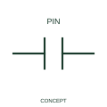

# One-line connector representation

A one-line connector representation identifies a connector interface in a simplified circuit view.

[Canonical reference](https://eloragrid.ai/symbols/iec-one-line-connector-representation) · [Structured record](../entries/iec-one-line-connector-representation.json) · [All references](README.md)

Updated: 2026-10-27. Drawing use: Schematic. Reference families: IEC, Manufacturer.

Graphical convention: IEC. One-line connector representation.

## What it represents

A one-line connector representation identifies a connector interface in a simplified circuit view.
Cross-reference the detailed connector pin list and conductor mapping.
One line can represent several conductors; it is not a declaration of a single-pin connector.

## How to read it

- Cross-reference the detailed connector pin list and conductor mapping.
- One line can represent several conductors; it is not a declaration of a single-pin connector.

## Drawing checklist

- Identify the associated device, circuit or diagram boundary.
- Cross-reference the detailed connector pin list and conductor mapping.
- Cross-reference the equipment data, terminal mapping or operating-state legend needed to interpret the form.

## Important distinction

One line can represent several conductors; it is not a declaration of a single-pin connector.

## Facts

- Reference scope: Specific public IEC-context family form
- Publisher reference token: HC01PJ\_1- (Autodesk token; not a verified IEC database ID)
- Information added: Cross-reference the detailed connector pin list and conductor mapping.
- Preview: Independent educational concept; consult the publisher and applicable standard for the exact graphic

## Public references

- [Autodesk IEC-60617 preview: One-line connector representation](https://help.autodesk.com/cloudhelp/2021/ENU/AutoCAD-Electrical/files/GUID-5A9FE181-1895-4CC4-949E-C5D2EF0E37E5.htm) — Autodesk. Official public publisher family name and reference context; vendor identifiers and graphics are distinct from licensed IEC database content.

## Related references

- [Terminal connection](terminal.md)
- [Busbar](busbar.md)

Original educational concept geometry, CC BY 4.0. Unitless; not a certified standards glyph or manufacturer footprint.

Elora-authored explanations are CC BY 4.0. Linked standards and manufacturer material retain their own rights. Confirm project requirements using primary sources.
