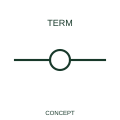

# One-line terminal representation

A one-line terminal identifies a termination point in a simplified circuit view.

[Canonical reference](https://eloragrid.ai/symbols/iec-one-line-terminal-representation) · [Structured record](../entries/iec-one-line-terminal-representation.json) · [All references](README.md)

Updated: 2026-10-27. Drawing use: Schematic. Reference families: IEC, Manufacturer.

Graphical convention: IEC. One-line terminal representation.

## What it represents

A one-line terminal identifies a termination point in a simplified circuit view.
Reference the terminal strip and detailed terminal numbers elsewhere in the drawing package.
Square and round presentation forms are kept together rather than treated as different terminal functions.

## How to read it

- Reference the terminal strip and detailed terminal numbers elsewhere in the drawing package.
- Square and round presentation forms are kept together rather than treated as different terminal functions.

## Drawing checklist

- Identify the associated device, circuit or diagram boundary.
- Reference the terminal strip and detailed terminal numbers elsewhere in the drawing package.
- Cross-reference the equipment data, terminal mapping or operating-state legend needed to interpret the form.

## Important distinction

Square and round presentation forms are kept together rather than treated as different terminal functions.

## Facts

- Reference scope: Specific public IEC-context family form
- Publisher reference token: HT0001\_1-, HT0002\_1- (Autodesk token; not a verified IEC database ID)
- Information added: Reference the terminal strip and detailed terminal numbers elsewhere in the drawing package.
- Preview: Independent educational concept; consult the publisher and applicable standard for the exact graphic

## Public references

- [Autodesk IEC-60617 preview: One-line terminal representation](https://help.autodesk.com/cloudhelp/2021/ENU/AutoCAD-Electrical/files/GUID-BF54B7FD-AAE1-4FE2-A8CF-07CFC96BFE5E.htm) — Autodesk. Official public publisher family name and reference context; vendor identifiers and graphics are distinct from licensed IEC database content.

## Related references

- [Terminal connection](terminal.md)
- [Busbar](busbar.md)

Original educational concept geometry, CC BY 4.0. Unitless; not a certified standards glyph or manufacturer footprint.

Elora-authored explanations are CC BY 4.0. Linked standards and manufacturer material retain their own rights. Confirm project requirements using primary sources.
