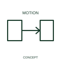

# One-way linear-motion qualifier

A linear-motion qualifier identifies movement or force in one documented direction.

[Canonical reference](https://eloragrid.ai/symbols/iec-one-way-linear-motion-qualifier) · [Structured record](../entries/iec-one-way-linear-motion-qualifier.json) · [All references](README.md)

Updated: 2026-10-27. Drawing use: Schematic. Reference families: IEC, Manufacturer.

Graphical convention: IEC. One-way linear-motion qualifier.

## What it represents

A linear-motion qualifier identifies movement or force in one documented direction. The arrow describes a mechanical movement or force along a line. The same logical relationship can be drawn in another orientation without changing the mechanism.
Distinguish movement arrows from electrical continuation arrows by their context and association with the mechanism. A movement diagram should name the driven element and reference its positions.

## How to read it

- Orient the indication to the actual diagram relationship; do not treat its drawing direction as an equipment compass bearing.
- Rotating the same motion indication does not create another engineering function.

## Drawing checklist

- Identify the associated device, circuit or diagram boundary.
- Orient the indication to the actual diagram relationship; do not treat its drawing direction as an equipment compass bearing.
- Cross-reference the equipment data, terminal mapping or operating-state legend needed to interpret the form.

## Important distinction

Rotating the same motion indication does not create another engineering function.

## Facts

- Reference scope: Specific public IEC-context family form
- Publisher reference token: Q020401R (Autodesk token; not a verified IEC database ID)
- Information added: Orient the indication to the actual diagram relationship; do not treat its drawing direction as an equipment compass bearing.
- Preview: Independent educational concept; consult the publisher and applicable standard for the exact graphic

## Public references

- [Autodesk IEC-60617 preview: Linear force and motion qualifiers](https://help.autodesk.com/cloudhelp/2021/ENU/AutoCAD-Electrical/files/GUID-D3F1AA20-F564-40CC-97D3-21EBA20E717A.htm) — Autodesk. Official public publisher family name and reference context; vendor identifiers and graphics are distinct from licensed IEC database content.

## Related references

- [Relay coil](relay-coil.md)
- [Normally open contact](normally-open-contact.md)

Original educational concept geometry, CC BY 4.0. Unitless; not a certified standards glyph or manufacturer footprint.

Elora-authored explanations are CC BY 4.0. Linked standards and manufacturer material retain their own rights. Confirm project requirements using primary sources.
