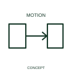

# One-way rotary-motion qualifier

A rotary-motion qualifier identifies movement or torque in one direction of rotation.

[Canonical reference](https://eloragrid.ai/symbols/iec-one-way-rotary-motion-qualifier) · [Structured record](../entries/iec-one-way-rotary-motion-qualifier.json) · [All references](README.md)

Updated: 2026-10-27. Drawing use: Schematic. Reference families: IEC, Manufacturer.

Graphical convention: IEC. One-way rotary-motion qualifier.

## What it represents

A rotary-motion qualifier identifies movement or torque in one direction of rotation. A rotary indication records the direction assigned to a mechanical movement. Its viewpoint matters when the mechanism and its control circuit are shown in separate drawings.
Use a stated viewing reference where rotation direction is significant. The arrow does not substitute for actual machine terminals, wiring or a phase-sequence specification.

## How to read it

- Relate the direction to the described mechanism and viewing convention.
- An arrow direction is not a complete motor phase-sequence or rotation instruction.

## Drawing checklist

- Identify the associated device, circuit or diagram boundary.
- Relate the direction to the described mechanism and viewing convention.
- Cross-reference the equipment data, terminal mapping or operating-state legend needed to interpret the form.

## Important distinction

An arrow direction is not a complete motor phase-sequence or rotation instruction.

## Facts

- Reference scope: Specific public IEC-context family form
- Publisher reference token: Q020403 (Autodesk token; not a verified IEC database ID)
- Information added: Relate the direction to the described mechanism and viewing convention.
- Preview: Independent educational concept; consult the publisher and applicable standard for the exact graphic

## Public references

- [Autodesk IEC-60617 preview: Rotary force and motion qualifiers](https://help.autodesk.com/cloudhelp/2021/ENU/AutoCAD-Electrical/files/GUID-A2633343-7A99-4CAF-BF09-F108A4714D55.htm) — Autodesk. Official public publisher family name and reference context; vendor identifiers and graphics are distinct from licensed IEC database content.

## Related references

- [Relay coil](relay-coil.md)
- [Normally open contact](normally-open-contact.md)

Original educational concept geometry, CC BY 4.0. Unitless; not a certified standards glyph or manufacturer footprint.

Elora-authored explanations are CC BY 4.0. Linked standards and manufacturer material retain their own rights. Confirm project requirements using primary sources.
