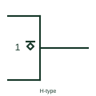

# IEC open-circuit output, H-type (open emitter)

Overlined diamond at an output: an open-emitter or open-source stage that can only drive a high level.

[Canonical reference](https://eloragrid.ai/symbols/iec-open-circuit-output-h-type) · [Structured record](../entries/iec-open-circuit-output-h-type.json) · [All references](README.md)

Updated: 2026-10-28. Drawing use: Schematic. Reference families: IEC, Manufacturer.

Graphical convention: IEC. Diamond with overline inside the outline at the output.

## What it represents

The H-type open-circuit output is drawn as a diamond with a line above it. It can supply a relatively low-impedance H level when on and is open when off, so it needs an external pull-down. TI's public overview notes it supports a positive-logic wired-OR connection.
Open-emitter outputs are typical of emitter-coupled logic and some line drivers. On a drawing the pull-down or termination must be shown, often to a negative or termination rail rather than to ground.
The qualifier does not give the termination value or rail. Those come from the logic family's application guidance and the device datasheet.

## How to read it

- Overline above the diamond: drives high only.
- Find the pull-down or termination on the net.

## Drawing checklist

- Draw the diamond with its overline next to the output.
- Show the pull-down or termination and its rail.
- Avoid joining H-type and L-type outputs on one net.

## Important distinction

The L-type output has its line under the diamond and drives low only.

## Facts

- Drives: High level only
- Wired connection: Wired-OR in positive logic
- Artwork scope: Original educational illustration; consult the applicable standard and the selected device documentation for the exact graphic

## Public references

- [Overview of IEEE Standard 91-1984: explanation of logic symbols (SDYZ001A)](https://www.ti.com/lit/ml/sdyz001a/sdyz001a.pdf) — Texas Instruments. Describes the H-type open-circuit output and wired-OR capability.

## Related references

- [IEC open-circuit output, L-type (open collector)](iec-open-circuit-output-l-type.md)
- [IEC three-state output qualifier](iec-three-state-output-qualifier.md)
- [Non-inverting logic buffer](logic-buffer.md)

Original educational concept geometry, CC BY 4.0. Unitless; not a certified standards glyph or manufacturer footprint.

Elora-authored explanations are CC BY 4.0. Linked standards and manufacturer material retain their own rights. Confirm project requirements using primary sources.
