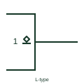

# IEC open-circuit output, L-type (open collector)

Underlined diamond inside an outline: an open-circuit output that can only drive a low level.

[Canonical reference](https://eloragrid.ai/symbols/iec-open-circuit-output-l-type) · [Structured record](../entries/iec-open-circuit-output-l-type.json) · [All references](README.md)

Updated: 2026-10-28. Drawing use: Schematic. Reference families: IEC, Manufacturer.

Graphical convention: IEC. Diamond with underline inside the outline at the output.

## What it represents

The underlined diamond marks an output, such as an NPN open collector or an N-channel open drain, that can supply a relatively low-impedance L level when on and is open when off. An external pull-up is needed. TI's public overview notes this output type supports a positive-logic wired-AND connection.
When a variant with a built-in passive pull-up exists, a further mark inside the diamond distinguishes it. Reviewing the exact qualifier tells the drafter whether an external pull-up must be added to the schematic.
The qualifier does not state the maximum pull-up voltage. Some open-drain outputs tolerate a higher pull-up rail than the device supply and some do not.

## How to read it

- Underline below the diamond: pulls low only.
- Find the external pull-up on the net.

## Drawing checklist

- Draw the diamond with its underline next to the output.
- Show the pull-up resistor.
- Record the permitted pull-up voltage.

## Important distinction

The H-type open-circuit output has the line above the diamond and drives a high level only.

## Facts

- Drives: Low level only
- Wired connection: Wired-AND in positive logic
- Artwork scope: Original educational illustration; consult the applicable standard and the selected device documentation for the exact graphic

## Public references

- [Overview of IEEE Standard 91-1984: explanation of logic symbols (SDYZ001A)](https://www.ti.com/lit/ml/sdyz001a/sdyz001a.pdf) — Texas Instruments. Describes the L-type open-circuit output qualifier and wired-AND capability.

## Related references

- [IEC open-circuit output, H-type (open emitter)](iec-open-circuit-output-h-type.md)
- [IEC open-collector buffer (rectangular form)](iec-open-collector-buffer.md)
- [ANSI wired-AND connection](ansi-wired-and-connection.md)

Original educational concept geometry, CC BY 4.0. Unitless; not a certified standards glyph or manufacturer footprint.

Elora-authored explanations are CC BY 4.0. Linked standards and manufacturer material retain their own rights. Confirm project requirements using primary sources.
