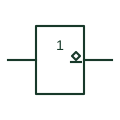

# IEC open-collector buffer (rectangular form)

IEC buffer with an underlined diamond at the output, showing an open-collector or open-drain stage.

[Canonical reference](https://eloragrid.ai/symbols/iec-open-collector-buffer) · [Structured record](../entries/iec-open-collector-buffer.json) · [All references](README.md)

Updated: 2026-10-28. Drawing use: Schematic. Reference families: IEC, Manufacturer.

Graphical convention: IEC. 1 element with the underlined-diamond open-circuit (L-type) output qualifier.

## What it represents

The underlined diamond inside the outline marks an output that can pull to a low level but needs an external pull-up to produce a high level. TI's public explanation describes this as suitable for a positive-logic wired-AND connection. The 1 qualifier makes the element non-inverting overall.
Open-collector outputs are used for shared alarm lines, level shifting to a higher pull-up voltage, and driving small relays or indicator lamps. The pull-up resistor or load must be shown on the drawing, together with its supply, because the element cannot produce a high level by itself.
The symbol does not state the maximum sink current or the maximum voltage the output may be pulled to. Those limits are device data and govern whether a relay coil or lamp can be connected directly.

## How to read it

- Find the pull-up resistor or load and its supply rail.
- Check whether several outputs are wired together.

## Drawing checklist

- Show the underlined diamond next to the output.
- Draw the pull-up and label its supply.
- Note the sink current and voltage limits where a load is driven directly.

## Important distinction

An overlined diamond is the H-type open-emitter output, which sources current and needs a pull-down.

## Facts

- Output qualifier: Diamond with underline (L-type open circuit)
- External part required: Pull-up resistor or load
- Wired connection: Positive-logic wired-AND
- Artwork scope: Original educational illustration; consult the applicable standard and the selected device documentation for the exact graphic

## Public references

- [Overview of IEEE Standard 91-1984: explanation of logic symbols (SDYZ001A)](https://www.ti.com/lit/ml/sdyz001a/sdyz001a.pdf) — Texas Instruments. Defines the open-collector output qualifier and its wired-AND capability.
- [SN74LS07 — open-collector output buffers](https://www.ti.com/lit/ds/symlink/sn74ls07.pdf) — Texas Instruments. Manufacturer open-collector buffer documentation.

## Related references

- [Open-collector buffer](open-collector-buffer.md)
- [IEC open-circuit output, L-type (open collector)](iec-open-circuit-output-l-type.md)
- [ANSI wired-AND connection](ansi-wired-and-connection.md)

Original educational concept geometry, CC BY 4.0. Unitless; not a certified standards glyph or manufacturer footprint.

Elora-authored explanations are CC BY 4.0. Linked standards and manufacturer material retain their own rights. Confirm project requirements using primary sources.
