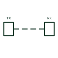

# Optical beam smoke detector plan symbol

Plan symbol for a linear optical beam smoke detector, showing transmitter, receiver or reflector and the beam path.

[Canonical reference](https://eloragrid.ai/symbols/iec-optical-beam-detector-plan-symbol) · [Structured record](../entries/iec-optical-beam-detector-plan-symbol.json) · [All references](README.md)

Updated: 2026-10-28. Drawing use: GA. Reference families: IEC.

Graphical convention: IEC. Optical beam detector.

## What it represents

Optical beam detectors protect large open spaces such as warehouses and atriums by projecting an infrared beam across the space. Plans show a transmitter and receiver, or a combined unit and reflector, linked by a dashed beam line drawn to length.
The beam path must remain clear of obstructions, and mounting surfaces must be stable so the beam stays aligned. The plan helps coordinate with racking, cranes and structure. The symbol does not state beam length limits or alignment tolerance. Product data sets these.

## How to read it

- Check the beam path is clear.
- Identify transmitter, receiver or reflector ends.

## Drawing checklist

- Show both ends and beam line.
- State beam length.
- Check mounting stability.

## Important distinction

A point smoke detector covers a radius; a beam detector covers a line across a space.

## Facts

- Coverage: Line of sight across open space
- Components: Transmitter and receiver, or unit and reflector
- Exact standard graphic: Not reproduced here; confirm the form against IEC 60617 and the project legend

## Public references

- [IEC graphical symbols for diagrams](https://tc3.iec.ch/tc-activity/graphical-symbols-for-diagrams/) — IEC. IEC graphical symbol context for installation plans; independently drawn here.
- [Autodesk IEC-60617 preview: Radiation qualifiers](https://help.autodesk.com/cloudhelp/2021/ENU/AutoCAD-Electrical/files/GUID-EABC81B4-549D-49C9-A0F5-086DD204A689.htm) — Autodesk. Public IEC-oriented radiation qualifiers relevant to optical and infrared detection marks.

## Related references

- [Smoke detector plan symbol](iec-smoke-detector-plan-symbol.md)
- [Signal-transmission qualifier](iec-signal-transmission-qualifier.md)

Original educational concept geometry, CC BY 4.0. Unitless; not a certified standards glyph or manufacturer footprint.

Elora-authored explanations are CC BY 4.0. Linked standards and manufacturer material retain their own rights. Confirm project requirements using primary sources.
