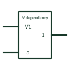

# IEC OR dependency (V)

Dependency label Vm: affected terminals are ORed with the V input, forced to 1 when V is active.

[Canonical reference](https://eloragrid.ai/symbols/iec-or-dependency-v) · [Structured record](../entries/iec-or-dependency-v.json) · [All references](README.md)

Updated: 2026-10-28. Drawing use: Schematic. Reference families: IEC, Manufacturer.

Graphical convention: IEC. Affecting input labelled Vm with affected terminals labelled m.

## What it represents

V dependency is the OR counterpart of G dependency. When the Vm affecting input is at its internal 1 state, every input or output labelled m is forced to its internal 1 state. When Vm is at 0, the affected signals act normally.
Device symbols use V dependency to show override or force functions, for example an output that can be forced active regardless of the normal logic. Recognising the letter avoids misreading the affected output as purely driven by the main function.
Like all dependency labels, V gives no timing information and does not imply a particular circuit. It is a compact statement of a logical relationship within the symbol.

## How to read it

- V forces affected terminals to 1; G forces them to 0.
- Look for a bar over the number for complemented action.

## Drawing checklist

- Label the affecting input with V and a number.
- Mark every affected terminal with the same number.
- Explain any override behaviour in the sheet notes.

## Important distinction

G dependency is the AND relationship; V is the OR relationship.

## Facts

- Affecting input at 1: Imposes 1 state
- Affecting input at 0: Permits action
- Artwork scope: Original educational illustration; consult the applicable standard and the selected device documentation for the exact graphic

## Public references

- [Overview of IEEE Standard 91-1984: explanation of logic symbols (SDYZ001A)](https://www.ti.com/lit/ml/sdyz001a/sdyz001a.pdf) — Texas Instruments. V (OR) dependency description and summary table.

## Related references

- [IEC AND dependency (G)](iec-and-dependency-g.md)
- [IEC negate dependency (N)](iec-negate-dependency-n.md)
- [IEC OR gate (rectangular form)](iec-or-gate.md)

Original educational concept geometry, CC BY 4.0. Unitless; not a certified standards glyph or manufacturer footprint.

Elora-authored explanations are CC BY 4.0. Linked standards and manufacturer material retain their own rights. Confirm project requirements using primary sources.
