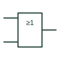

# IEC OR gate (rectangular form)

IEC rectangular OR element labelled ≥1, meaning at least one active input is needed to activate the output.

[Canonical reference](https://eloragrid.ai/symbols/iec-or-gate) · [Structured record](../entries/iec-or-gate.json) · [All references](README.md)

Updated: 2026-10-28. Drawing use: Schematic. Reference families: IEC, Manufacturer.

Graphical convention: IEC. Rectangular outline with the ≥1 general qualifying symbol.

## What it represents

The ≥1 qualifier inside a rectangular outline identifies an OR function. The notation literally reads as at least one input active, which is why the same family of symbols uses ≥m for threshold functions in other contexts. Inputs are drawn on the left and the output on the right unless an arrow indicates otherwise.
On trip logic and permissive diagrams the ≥1 box often collects several fault signals into a single trip command. Because every input is equal, the drawing should label each incoming signal with its source tag so that a reader can trace which condition caused the output during testing.
The symbol does not state whether the inputs are latched, filtered or time-delayed. Any such behaviour must be shown by separate elements or by labels; the OR box itself is purely combinative.

## How to read it

- Trace each input back to its source tag; the box does not identify which input fired.
- A circle at the output turns the element into a NOR function.

## Drawing checklist

- Write ≥1 legibly; do not abbreviate to 1, which is the buffer qualifier.
- Label each input signal with its source.
- Show negation at inputs or output explicitly.

## Important distinction

A box marked 1 alone is a buffer or single-input element; ≥1 is required for the OR function.

## Facts

- General qualifier: ≥1 (at least one input active)
- Typical use: Collecting several trip or alarm conditions
- Artwork scope: Original educational illustration; consult the applicable standard and the selected device documentation for the exact graphic

## Public references

- [Overview of IEEE Standard 91-1984: explanation of logic symbols (SDYZ001A)](https://www.ti.com/lit/ml/sdyz001a/sdyz001a.pdf) — Texas Instruments. Defines ≥1 as the OR qualifier and explains why it was chosen.
- [SN74HC32 — OR gate logic](https://www.ti.com/lit/ds/symlink/sn74hc32.pdf) — Texas Instruments. Manufacturer OR gate documentation.

## Related references

- [OR gate](logic-or-gate.md)
- [IEC NOR gate (rectangular form)](iec-nor-gate.md)
- [IEC AND gate (rectangular form)](iec-and-gate.md)

Original educational concept geometry, CC BY 4.0. Unitless; not a certified standards glyph or manufacturer footprint.

Elora-authored explanations are CC BY 4.0. Linked standards and manufacturer material retain their own rights. Confirm project requirements using primary sources.
