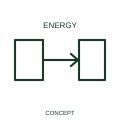

# Outbound-energy-flow qualifier

An outbound-energy qualifier identifies energy leaving the represented device or boundary.

[Canonical reference](https://eloragrid.ai/symbols/iec-outbound-energy-flow-qualifier) · [Structured record](../entries/iec-outbound-energy-flow-qualifier.json) · [All references](README.md)

Updated: 2026-10-27. Drawing use: SLD, Schematic. Reference families: IEC, Manufacturer.

Graphical convention: IEC. Outbound-energy-flow qualifier.

## What it represents

An outbound-energy qualifier identifies energy leaving the represented device or boundary. The arrow’s meaning is relative to a chosen device or system boundary. A converter may export energy through one port while consuming energy at another.
State the boundary and operating mode alongside the diagram. Keep import/export sign conventions consistent with the metering and control documentation.

## How to read it

- Define the boundary and the operating condition for which the arrow is meaningful.
- Energy-flow direction can differ from the drawing's reference current direction.

## Drawing checklist

- Identify the associated device, circuit or diagram boundary.
- Define the boundary and the operating condition for which the arrow is meaningful.
- Cross-reference the equipment data, terminal mapping or operating-state legend needed to interpret the form.

## Important distinction

Energy-flow direction can differ from the drawing's reference current direction.

## Facts

- Reference scope: Specific public IEC-context family form
- Publisher reference token: Q020506 (Autodesk token; not a verified IEC database ID)
- Information added: Define the boundary and the operating condition for which the arrow is meaningful.
- Preview: Independent educational concept; consult the publisher and applicable standard for the exact graphic

## Public references

- [Autodesk IEC-60617 preview: Energy-flow qualifiers](https://help.autodesk.com/cloudhelp/2021/ENU/AutoCAD-Electrical/files/GUID-2039C5DD-1C01-4D77-AD97-584052C53D75.htm) — Autodesk. Official public publisher family name and reference context; vendor identifiers and graphics are distinct from licensed IEC database content.

## Related references

- [Power converter / inverter](power-converter.md)
- [PLC input / output](plc-io.md)

Original educational concept geometry, CC BY 4.0. Unitless; not a certified standards glyph or manufacturer footprint.

Elora-authored explanations are CC BY 4.0. Linked standards and manufacturer material retain their own rights. Confirm project requirements using primary sources.
