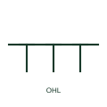

# Overhead line

A line or route mark identifying conductors carried overhead on poles or towers rather than buried or enclosed.

[Canonical reference](https://eloragrid.ai/symbols/iec-overhead-line) · [Structured record](../entries/iec-overhead-line.json) · [All references](README.md)

Updated: 2026-10-28. Drawing use: SLD, GA. Reference families: IEC.

Graphical convention: IEC. Overhead line route form.

## What it represents

The overhead line form identifies a circuit section strung in air between supports. On network single-line diagrams it distinguishes overhead feeders from underground cable sections, which matters because the two have different impedance, fault behaviour, auto-reclose practice and lightning exposure.
The symbol does not tell you the conductor type, span lengths, earth wire arrangement or structure type. Line data sheets and route drawings carry those. Where a feeder changes from overhead to underground, look for a cable sealing end or transition point drawn at the junction.

## How to read it

- Note where the feeder changes between overhead and underground sections.
- Check whether auto-reclose is applied to feeders with overhead sections.

## Drawing checklist

- Identify conductor type and route length.
- Mark transition points to underground cable.
- Reference structure and earth-wire details on route drawings.

## Important distinction

An overhead line is strung in air; an underground cable is buried and has very different capacitance and fault characteristics.

## Facts

- Graphic cue: Line with pole or support marks along its length
- Engineering impact: Impedance, lightning exposure and reclosing practice
- Preview: Original educational illustration; consult the publisher and applicable standard for the exact graphic

## Public references

- [IEC-60617 symbol preview directory](https://help.autodesk.com/cloudhelp/2021/ENU/AutoCAD-Electrical/files/GUID-7871E6EF-24D5-467E-9B74-321FEDC9DFDA.htm) — Autodesk. Public directory of IEC-oriented symbol families.
- [Building protection system](https://www.electrical-installation.org/enwiki/Building_protection_system) — Schneider Electric, Electrical Installation Guide. Public installation-guide context on lightning exposure of external conductors.

## Related references

- [Underground cable](iec-underground-cable.md)
- [Multicore cable sealing end](iec-multicore-cable-sealing-end.md)
- [Surge arrester](surge-arrester.md)

Original educational concept geometry, CC BY 4.0. Unitless; not a certified standards glyph or manufacturer footprint.

Elora-authored explanations are CC BY 4.0. Linked standards and manufacturer material retain their own rights. Confirm project requirements using primary sources.
