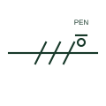

# PEN conductor mark

A mark identifying a combined protective and neutral conductor, as used in TN-C sections of a supply.

[Canonical reference](https://eloragrid.ai/symbols/iec-pen-conductor-mark) · [Structured record](../entries/iec-pen-conductor-mark.json) · [All references](README.md)

Updated: 2026-10-28. Drawing use: SLD, Schematic. Reference families: IEC.

Graphical convention: IEC. PEN conductor identification on a conductor group.

## What it represents

The PEN mark identifies one conductor that performs both the protective and neutral functions. It appears in TN-C and TN-C-S arrangements, typically between the supply transformer and the main switchboard, where the PEN is later separated into N and PE at a defined point.
A PEN conductor must not be switched or isolated on its own, and once separated into N and PE the two must not be rejoined downstream. A drawing that shows a PEN mark should therefore also show the separation point clearly. The mark says nothing about minimum conductor size, which local wiring rules set for PEN conductors.

## How to read it

- Find the point where the PEN is split into N and PE.
- Check that no switching device opens the PEN conductor alone.

## Drawing checklist

- Show the PEN to N and PE separation point.
- Avoid single-pole switching of the PEN.
- Confirm PEN sizing against the applicable wiring rules.

## Important distinction

A PEN conductor combines N and PE functions; a neutral mark shows a conductor that has no protective role.

## Facts

- Graphic cue: Combined neutral and earth mark on one stroke
- Letter code: PEN
- Scheme context: TN-C and TN-C-S sections
- Preview: Original educational illustration; consult the publisher and applicable standard for the exact graphic

## Public references

- [Definition of standardised earthing schemes](https://www.electrical-installation.org/enwiki/Definition_of_standardised_earthing_schemes) — Schneider Electric, Electrical Installation Guide. Public installation-guide definitions of TN-C and TN-C-S schemes.
- [Earthing connections](https://www.electrical-installation.org/enwiki/Earthing_connections) — Schneider Electric, Electrical Installation Guide. Public guide to earthing connection elements.

## Related references

- [Neutral conductor mark](iec-neutral-conductor-mark.md)
- [Protective conductor mark](iec-protective-conductor-mark.md)
- [Neutral-to-earth link](iec-men-link.md)

Original educational concept geometry, CC BY 4.0. Unitless; not a certified standards glyph or manufacturer footprint.

Elora-authored explanations are CC BY 4.0. Linked standards and manufacturer material retain their own rights. Confirm project requirements using primary sources.
