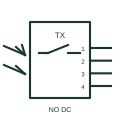

# IEC photoelectric emitter interface: normally open 4 wire

Photoelectric emitter interface form: Normally Open 4 wire.

[Canonical reference](https://eloragrid.ai/symbols/iec-photoelectric-emitter-interface-normally-open-4-wire) · [Structured record](../entries/iec-photoelectric-emitter-interface-normally-open-4-wire.json) · [All references](README.md)

Updated: 2026-10-28. Drawing use: Schematic. Reference families: IEC, Manufacturer.

Graphical convention: IEC. Normally Open 4 wire.

## What it represents

A photoelectric emitter supplies the light used by an optical sensing system; a complete sensing pair also needs a receiver. This entry identifies the normally open 4 wire form in the publisher's IEC-context family.
A conveyor may place the emitter on one side and a separate receiver on the other so an object can interrupt the optical path. The normally-open designation starts with a non-conducting output or open contact in the documented reference condition; operation changes that state. The additional connection points need the actual pin assignment. A fourth or fifth pin may serve an output or control function; pin count alone does not define its purpose.
A supply connection to an emitter is different from a switched detection output. Check the listed terminal and output form rather than assuming every optical device has the same interface.

## How to read it

- The normally-open designation starts with a non-conducting output or open contact in the documented reference condition; operation changes that state.
- The additional connection points need the actual pin assignment. A fourth or fifth pin may serve an output or control function; pin count alone does not define its purpose.
- A supply connection to an emitter is different from a switched detection output. Check the listed terminal and output form rather than assuming every optical device has the same interface.

## Drawing checklist

- Identify the target, sensing mode and expected normal condition.
- Label supply, output and connector pins from the actual device diagram.
- Reference output circuit type, operating range and controller input.

## Important distinction

This entry adds the normally open 4 wire detail to the broader photoelectric emitter interface family. A supply connection to an emitter is different from a switched detection output. Check the listed terminal and output form rather than assuming every optical device has the same interface.

## Facts

- Drawing form: Normally Open 4 wire
- Public vendor block names: HPE11PE4 / VPE11PE4. Autodesk identifiers, not standards database IDs.
- Drawing purpose: photoelectric emitter interface
- Graphic scope: Independently authored educational illustration; not certified standard geometry, a terminal pinout or a product footprint.

## Public references

- [Autodesk IEC-60617 Symbol Preview: Photoelectric Emitter Switches](https://help.autodesk.com/cloudhelp/2021/ENU/AutoCAD-Electrical/files/GUID-CAF5714C-3562-40A0-A957-AB06150A5658.htm) — Autodesk. Public Photoelectric Emitter Switches table explicitly lists HPE11PE4 / VPE11PE4 with this operating or connection form. Vendor graphics are linked, not copied.

## Related references

- [Photoelectric emitter-receiver switch](photoelectric-emitter-receiver-switch.md)
- [PLC digital input](plc-digital-input.md)
- [Terminal connection](terminal.md)

Original educational concept geometry, CC BY 4.0. Unitless; not a certified standards glyph or manufacturer footprint.

Elora-authored explanations are CC BY 4.0. Linked standards and manufacturer material retain their own rights. Confirm project requirements using primary sources.
